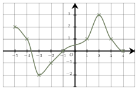
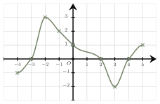


On considère la fonction $f$ définie par $f(x)=2x^2+2x+2$.

Calculer l'image de $-3$ par la fonction $f$.
---CORR---
On a :
$$\begin{aligned}
f(-3)&=2\times(-3)^2+2\times (-3)+2\\
&=2\times 9-6+2\\
&=18-6+2\\
&=14
\end{aligned}$$.



On considère le nombre $N=\dfrac{10^4}{5^2}$.

Écrire $N$ sous la forme $a\times 10^{2}$, où $a$ est un entier.
---CORR---
$$\begin{aligned}
N&=\dfrac{10^4}{5^2}\\
&=\dfrac{5^4\times 2^4 }{5^2}\\
&=2^4\times 5^{2}\\
&=10^2\times 2^{2}\\
&=4\times 10^{2}
\end{aligned}$$



Factoriser l'expression $9x^2-100$.
---CORR---
On reconnaît le développement de l'égalité remarquable :  
$(a+b)(a-b)=a^2-b^2$ avec $a=3x$ et $b=10$.  
On a donc :
$9x^2-100=(3x-10)(3x+10)$



On considère $A=\dfrac{27}{1\ 000}+\dfrac{267}{100}$.

Donner l'écriture décimale de $A$.
---CORR---
On a :

$$\begin{aligned}
A&=\dfrac{27}{1\ 000}+\dfrac{267}{100}\\
&=0{,}027+2{,}67\\
&=2{,}697
\end{aligned}$$



On considère la droite d'équation $y=5$.

Donner son coefficient directeur $m$.
---CORR---
On reconnaît l'équation réduite d'une droite de la forme $y=mx+p$ où $m$ est son coefficient directeur. 
Ici, $m=0$ et $p=5$.



Voici la représentation graphique d'une fonction $f$.

Lire l'image de $-3$ par $f$.
---CORR---
Pour lire l'image de $-3$, on place la valeur de $-3$ sur l'axe des abscisses (axe de lecture  des antécédents) et on lit
son image  sur l'axe des ordonnées (axe de lecture des images). 
On obtient :  $f(-3)=-2$



On considère la fonction $f$ définie par $f(x)=(2x-2)(3x+2)$.

Calculer l'image de $-5$ par la fonction $f$.
---CORR---
On a : 

$$
\begin{aligned}
f(-5)&=\left(2\times(-5)-2\right)\left(3\times(-5)+2\right)\\
&=(-10-2)(-15+2)\\
&= -12\times(-13)=\boldsymbol{156}
\end{aligned}
$$

Mentalement :  
On commence par "calculer" la première parenthèse :  $2\times(-5)-2=-12$.

Puis la deuxième : $3\times(-5)+2=-13$. 
On fait le produit des nombres obtenus : $-12\times (-13)=156$.



On considère le nombre $N=\dfrac{6^4}{2^2}$.

Écrire $N$ sous la forme $a\times 6^{2}$, où $a$ est un entier.
---CORR---
$$
\begin{aligned}
N&=\dfrac{6^4}{2^2}\\
&=\dfrac{2^4\times 3^4 }{2^2}\\
&=3^4\times 2^{2}\\
&=6^2\times 3^{2}\\
&=\boldsymbol{9\times 6^{2}}
\end{aligned}
$$



Factoriser l'expression $4x^2-4x+1$.
---CORR---
On reconnaît le développement de l'égalité remarquable :  
$(a-b)^2=a^2-2ab+b^2$ avec $a=2x$ et $b=1$. 
On a donc :

$4x^2-4x+1=\boldsymbol{(2x-1)^2}$



On considère $A=\dfrac{92}{100}+\dfrac{18}{1\ 000}$.

Donner l'écriture décimale de $A$.
---CORR---
On a :

$$
\begin{aligned}
A&=\dfrac{92}{100}+\dfrac{18}{1\,000}\\
&=0{,}92+0{,}018\\
&=\boldsymbol{0{,}938}
\end{aligned}
$$



On considère la droite d'équation $y=\dfrac{x}{4}-6$.

Donner son coefficient directeur $m$.
---CORR---
On reconnaît l'équation réduite d'une droite de la forme $y=mx+p$ où $m$ est son coefficient directeur. 
Ici, $m=\boldsymbol{\dfrac{1}{4}}$ et $p=-6$.



Voici la représentation graphique d'une fonction $f$.

Lire l'image de $-1$ par $f$.
---CORR---
Pour lire l'image de $-1$, on place la valeur de $-1$ sur l'axe des abscisses (axe de lecture  des antécédents) et on lit
son image  sur l'axe des ordonnées (axe de lecture des images). On obtient :  $f(-1)=\boldsymbol{2}$


