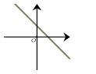


Choisir deux nombres puis calculer l'inverse de leur somme.

Quel résultat obtient-on si on choisit les nombres $-1$ et $7$ ?
---CORR---
La somme de $-1$ et $7$ est $6$.

Son inverse est : $\dfrac{1}{6}$.



On donne la relation $9a+10y=5$.

Exprimer $a$ en fonction de $y$.
---CORR---
De la relation $9a+10y=5$, on déduit en ajoutant $-10y$ dans chaque membre :
$9a=5-10y$

Puis, en divisant par $9$, on obtient : $ a=\dfrac{5-10y}{9}$.



On considère une fonction affine $f$ telle que $f(4)=-11$ et $f(8)=-19$.

Calculer l'image de $12$ par $f$.
---CORR---
$f$ est une fonction affine, elle est donc de la forme $f(x)=mx+p$.

$\begin{aligned}
m&=\dfrac{f(8)-f(4)}{8-4}\\
&=\dfrac{-19+11}{4}\\
&=-2
\end{aligned}$

On a donc $f(x)=-2x+p$.

Pour déterminer $p$, on utilise la valeur de $f(4)$ :

$\begin{aligned}
f(4)&=-2\times 4+p\\
-11&=-8+p\\
p&=-3
\end{aligned}$

On a donc $f(x)=-2x-3$.

L'image de $12$ par cette fonction est :

$\begin{aligned}
f(12)&=-2\times 12  -3
\\&=-24-3\\
&=-27
\end{aligned}$



Développer et réduire $(3a+2)^2$.
---CORR---
On utilise l'égalité remarquable $(a+b)^2=a^2+2ab+b^2$ avec $a=3a$ et $b=2$.

$\begin{aligned}
(3a+2)^2&=(3a)^2+2 \times 3a \times 2 + 2^2\\
&=9a^2+12a+4
\end{aligned}$



Voici quatre droites.

$D_1$

$D_2$

$D_3$

$D_4$

Laquelle de ces droites peut avoir pour équation $y=6x-5$ ?
---CORR---
On reconnaît la droite grâce à son ordonnée à l'origine ($-5<0$) et son coefficient directeur ($6>0$).

Il s'agit de la droite coupant l'axe des ordonnées en-dessous de l'axe des abscisses et qui monte.

Il s'agit de la droite $D_1$.



Le prix d'un vêtement est $35$ €. Il baisse de $20\ $%.

Calculer son nouveau prix.
---CORR---
Le nouveau prix est de $28 $ €.

Mentalement :

On calcule d'abord le montant de la réduction.

Pour calculer $20\ $% d'une quantité, on commence par calculer $10\ $% en divisant
par $10$ :

$10\ $% de $35$ est égal à $35\div 10=3,5$.

Puisque $20\ $% est deux fois plus grand que $10\ $%, $20\ $% de $35$ est égal à $2\times 3,5=7$.

La réduction est donc de : $7$ €.

Le nouveau prix est : $35-7= 28$ €.



Choisir deux nombres puis calculer le double de leur produit.

Quel résultat obtient-on si on choisit les nombres $4$ et $2$ ?
---CORR---
$2\times4\times 2=\boldsymbol{16}$



On donne la relation $3x-2c=2$.

Exprimer $x$ en fonction de $c$.
---CORR---
De la relation $3x-2c=2$, on déduit en ajoutant $2c$ dans chaque membre :
$3x=2+2c$ 
Puis, en divisant par $3$, on obtient : $\boldsymbol{ x=\dfrac{2+2c}{3}}$.



On considère une fonction affine $f$ telle que $f(5)=2$ et $f(7)=0$.

Calculer l'image de $12$ par $f$.
---CORR---
$f$ est une fonction affine, elle est donc de la forme $f(x)=mx+p$. 

$$
\begin{aligned}
m&=\dfrac{f(7)-f(5)}{7-5}\\
&=\dfrac{0-2}{2}\\
&=-1
\end{aligned}
$$

On a donc $f(x)=-x+p$. 
Pour déterminer $p$, on utilise la valeur de $f(5)$ : 

$$
\begin{aligned}
f(5)&=-1\times 5+p\\
2&=-5+p\\
p&=7
\end{aligned}
$$

On a donc $f(x)=-x+7$. 
L'image de $12$ par cette fonction est : 

$$
\begin{aligned}
f(12)&=-1\times 12  +7\\
&=-12+7\\
&=\boldsymbol{-5}
\end{aligned}
$$



Développer et réduire $(2x-9)(2x+9)$.
---CORR---
On utilise l'égalité remarquable $(a+b)(a-b)=a^2-b^2$ avec $a=2x$ et $b=9$. 

$$
\begin{aligned}
(2x-9)(2x+9)&=(2x)^2-9^2\\
&=\boldsymbol{4x^2-81}
\end{aligned}
$$



Voici quatre droites.

$D_1$

$D_2$

$D_3$

$D_4$

Laquelle de ces droites peut avoir pour équation $y=-6x-10$ ?
---CORR---
On reconnaît la droite grâce à son ordonnée à l'origine ($-10<0$) et son coefficient directeur ($-6<0$). 
Il s'agit de la droite coupant l'axe des ordonnées en-dessous de l'axe des abscisses et qui descend. 
Il s'agit de la droite $\boldsymbol{D_1}$.



Le prix d'un vêtement est $50$ €. Il augmente de $20\ $%.

Calculer son nouveau prix.
---CORR---
Le nouveau prix est :  $ \boldsymbol{60} $\,€.

Mentalement :  
On calcule d'abord le montant de l'augmentation.  
Pour calculer $20\,\%$ d'une quantité, on commence par calculer $10\,\%$  en divisant
par $10$ : 
$10\,\%$  de $50$ est égal à $50\div 10=5$. 
Puisque $20\,\%$  est deux fois plus grand que $10\,\%$,  $20\,\%$  de $50$ est égal à $2\times 5=10$. 
L'augmentation est donc de : $10$\,€. 
Le nouveau prix est :   $50+10= \boldsymbol{60}$ \,€.


