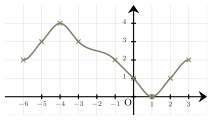
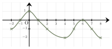


Calculer $A=\dfrac{4}{5-\dfrac{2}{3}}$ et donner le résultat sous forme de fraction irréductible.
---CORR---
$\begin{aligned}
A &= \dfrac{4}{5-\dfrac{2}{3}} \\
&= \dfrac{4}{\dfrac{15}{3}-\dfrac{2}{3}} \\
&= \dfrac{4}{\dfrac{13}{3}} \\
&= 4 \times \dfrac{3}{13} \\
&= \dfrac{12}{13}
\end{aligned}$



Soient $K$, $L$, $I$ et $J$ quatre nombres (avec $J$ non nul) vérifiant l'égalité $K=\dfrac{L+I}{J}$.

Exprimer $L$ en fonction de $K$, $I$ et $J$.
---CORR---
On isole $L$ dans un membre de l'égalité :

$\begin{aligned}
K &= \dfrac{L + I}{J}\\
K \times J &= L + I\\
K \times J - I &= L
\end{aligned}$

Une expression de $L$ en fonction de $K$, $I$ et $J$ est $L = J \times K - I$.



Voici la représentation graphique d'une fonction $f$.

Déterminer graphiquement l'ensemble des antécédents de $2$ par $f$.
---CORR---
Déterminer les antécédents de $2$ revient à déterminer les nombres qui ont pour image $2$.

On part de $2$ sur l'axe des ordonnées et on lit les antécédents (éventuels) sur l'axe des abscisses.

On en trouve $3$ : $-6\ ;\ -1\ ;\ 3$.



Par quel nombre faut-il multiplier une valeur pour l'augmenter de $40~\%$ ?
---CORR---
Augmenter de $40~\%$ revient à multiplier par $1+\dfrac{40}{100}$.

Ainsi, le coefficient multiplicateur associé à une augmentation de $40~\%$ est $1+0{,}4$, soit $1{,}4$.



Le plan est muni d'un repère orthogonal. On considère les points $A(-3\ ;\ 2)$ et $E(-10\ ;\ -8)$.

Calculer le coefficient directeur $m$ de la droite $(AE)$.
---CORR---
Le coefficient directeur $m$ de la droite $(AE)$ est donnée par la formule : $\dfrac{y_{E}-y_{A}}{x_{E}-x_{A}}$.

$\begin{aligned}
m&=\dfrac{-8-2}{-10-(-3)}\\
&= \dfrac{-10}{-7}\\
&=\dfrac{10}{7}
\end{aligned}$



Soit $f$ la fonction définie par $f(x)=\dfrac{2}{3}x-4$.

Calculer l'image de $2$ par $f$.
---CORR---
Comme $f(x)=\dfrac{2}{3}x-4$, on a :

$\begin{aligned}
f(2)&=\dfrac{2}{3}\times 2-4\\
&=\dfrac{4}{3}-4\\
&=-\dfrac{8}{3}
\end{aligned}$



Calculer $A=\dfrac{2}{3-\dfrac{2}{5}}$ et donner le résultat sous forme de fraction irréductible.
---CORR---
$$
\begin{aligned}
A &= \dfrac{2}{3-\dfrac{2}{5}} \\
&= \dfrac{2}{\dfrac{15}{5}-\dfrac{2}{5}} \\
&= \dfrac{2}{\dfrac{13}{5}} \\
&= 2 \times \dfrac{5}{13} \\
&= \boldsymbol{\dfrac{10}{13}}
\end{aligned}
$$



Soient $I$, $K$, $L$ et $J$ quatre nombres (avec $J$ non nul) vérifiant l'égalité $I=K-LJ$.

Exprimer $L$ en fonction de $I$, $K$ et $J$.
---CORR---
On isole $L$ dans un membre de l'égalité : 

$$
\begin{aligned}
I &= K - LJ\\
I - K &= -LJ\\
-I + K &= LJ\\
\dfrac{-I + K}{J} &= L
\end{aligned}
$$

Une expression de $L$ en fonction de $I$, $K$ et $J$ est $\boldsymbol{L = \dfrac{K - I}{J}}$.



Voici la représentation graphique d'une fonction $f$.

Déterminer graphiquement l'ensemble des antécédents de $0$ par $f$.
---CORR---
Déterminer les antécédents de $0$ revient à déterminer les nombres qui ont pour image $0$. 
On part de $0$ sur l'axe des ordonnées et on lit les antécédents (éventuels) sur l'axe des abscisses. 
On en trouve $3$ : $\boldsymbol{-1\,;\,1\,;\,6}$.



Par quel nombre faut-il multiplier une valeur pour l'augmenter de $90~\%$ ?
---CORR---
Augmenter de $90~\%$ revient à multiplier par $1+\dfrac{90}{100}$. 
Ainsi, le coefficient multiplicateur associé à une augmentation de $90~\%$ est $1+0{,}9$, soit $1{,}9$.

Autre formulation :  
Augmenter de $90~\%$ une valeur revient à en prendre $190~\%$ car $100~\% + 90 ~\%=190~\%$. 
Ainsi, le coefficient multiplicateur associé à une augmentation de $90~\%$ est $\dfrac{190}{100}$ soit $\boldsymbol{1{,}9}$.



Le plan est muni d'un repère orthogonal. On considère les points $C(-7\ ;\ 5)$ et $F(4\ ;\ -3)$.

Calculer le coefficient directeur $m$ de la droite $(CF)$.
---CORR---
Le coefficient directeur $m$ de la droite  $(CF)$ est donnée par la formule : $\dfrac{y_{F}-y_{C}}{x_{F}-x_{C}}$. 

$$
\begin{aligned}
m&=\dfrac{-3-5}{4-(-7)}\\
&= \dfrac{-8}{11}\\
&=\boldsymbol{-\dfrac{8}{11}}
\end{aligned}
$$



Soit $p$ la fonction définie par $p(x)=\dfrac{5}{3}x-4$.

Calculer l'image de $2$ par $p$.
---CORR---
Comme $p(x)=\dfrac{5}{3}x-4$, on a : 

$$
\begin{aligned}
p(2)&=\dfrac{5}{3}\times 2-4\\
&=\dfrac{10}{3}-4\\
&=\boldsymbol{-\dfrac{2}{3}}
\end{aligned}
$$


