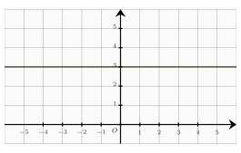
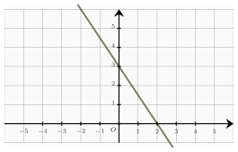
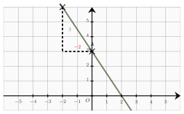


Dans un lycée, il y a $1\ 000$ élèves inscrits. $20\ $% d'entre eux étudient l'espagnol.

Combien d'élèves étudient l'espagnol ?
---CORR---
$20\ $% de $1\ 000  = 0{,}2 \times 1\ 000 = 200$

Donc $200$ élèves étudient l'Espagnol.



Dans un repère du plan, on a représenté une droite.

Donner le coefficient directeur de cette droite.
---CORR---
La droite est horizontale. On en déduit que son coefficient directeur est $m=0$.



Ranger dans l'ordre croissant les nombres suivants :

$$32\times 10^{-2}\ ;\quad \dfrac{3}{10}\ ;\quad \dfrac{28}{100}\ ;\quad 0{,}31$$
---CORR---
Pour comparer ces quatre nombres, on les écrit sous forme décimale :

$\dfrac{3}{10} = 0{,}3$

$\dfrac{28}{100} = 0{,}28$

$32 \times 10^{-2} = 0{,}32$

$0{,}31$

On a donc : $0{,}28 < 0{,}3 < 0{,}31 < 0{,}32$.

Dans l'ordre croissant : $\boldsymbol{\dfrac{28}{100}<\dfrac{3}{10}<0{,}31<32\times 10^{-2}}$.



Soit $x$ un réel non nul.

Écrire $\dfrac{1}{6}-\dfrac{5x+3}{x}$ sous la forme d'un seul quotient.
---CORR---
On met l'expression au même dénominateur :

$\begin{aligned}
\dfrac{1}{6}-\dfrac{5x+3}{x}&=\dfrac{x-6\times \left(5x+3\right)}{6x}\\
&=\dfrac{x -30x -18}{6x}\\
&=\dfrac{-29x -18}{6x}\\
\end{aligned}$

$\phantom{\dfrac{1}{6}-\dfrac{5x+3}{x}}=-\dfrac{29x +18}{6x}$



On considère des réels $x$, $y$ et $u$ non nuls tels que $\dfrac{x}{y}+2=\dfrac{5}{u}$.

Exprimer $u$ en fonction de $x$ et $y$.
---CORR---
On isole $u$ dans le premier membre :

$\begin{aligned}
\dfrac{x}{y}+2&= \dfrac{5}{u} \\
\dfrac{x+2y}{y}&= \dfrac{5}{u} \\
u&=\dfrac{5\times y}{x+2y} \\
u&= \dfrac{5y}{x+2y}
\end{aligned}$



Une augmentation de $10\ $% est suivie d'une augmentation de $20\ $%.

À quelle évolution globale cela correspond-il ?
---CORR---
À partir des évolutions en pourcentage, on déduit les coefficients multiplicateurs :

On note $CM_1 = 1 + \dfrac{10}{100}=1{,}1$ et $CM_2 = 1 + \dfrac{20}{100}=1{,}2$.

Le coefficient multiplicateur global est :

$CM = CM_1 \times CM_2 = 1{,}1 \times 1{,}2 = 1{,}32$

Or, multiplier par $1{,}32$ revient à avoir **une** **augmentation** **de** $32\ $%.



Dans un lycée, il y a $400$ élèves inscrits. $20\ $% d'entre eux étudient l'espagnol.

Combien d'élèves étudient l'espagnol ?
---CORR---
$20\,\%$ de $400  = 0{,}2 \times 400 = \boldsymbol{80}$ 
Donc $\boldsymbol{80}$ élèves étudient l'Espagnol.



Dans un repère du plan, on a représenté une droite.

Déterminer graphiquement le coefficient directeur de cette droite.
---CORR---
En prenant deux points sur la droite, on obtient : 
$m=\dfrac{\boldsymbol{3}}{\boldsymbol{-2}}=\boldsymbol{-\dfrac{3}{2}}$ 




Ranger dans l'ordre croissant les nombres suivants :

$$\dfrac{4}{5}\ ;\quad \dfrac{85}{100}\ ;\quad 9\times 10^{-1}\ ;\quad 0{,}88$$
---CORR---
Pour comparer ces quatre nombres, on les écrit sous forme décimale :

$\dfrac{4}{5} = 0{,}8$

$\dfrac{85}{100} = 0{,}85$

$9 \times 10^{-1} = 0{,}9$

$0{,}88$

On a donc : $0{,}8 < 0{,}85 < 0{,}88 < 0{,}9$. 
Dans l'ordre croissant : $\boldsymbol{\dfrac{4}{5}<\dfrac{85}{100}<0{,}88<9\times 10^{-1}}$.



Soit $x$ un réel non nul.

Écrire $\dfrac{1}{3}-\dfrac{4x+4}{x}$ sous la forme d'un seul quotient.
---CORR---
On met l'expression au même dénominateur :  

$$
\begin{aligned}
\dfrac{1}{3}-\dfrac{4x+4}{x}&=\dfrac{x-3\times \left(4x+4\right)}{3x}\\
&=\dfrac{x -12x -12}{3x}\\
&=\dfrac{-11x -12}{3x}\\
\end{aligned}
$$

$\phantom{\dfrac{1}{3}-\dfrac{4x+4}{x}}=-\dfrac{11x +12}{3x}$



On considère des réels $x$, $y$ et $u$ non nuls tels que $\dfrac{2}{x}+\dfrac{3}{y}=\dfrac{4}{u}$.

Exprimer $u$ en fonction de $x$ et $y$.
---CORR---
On isole $u$ dans le premier membre :  

$$
\begin{aligned} \dfrac{2}{x}+\dfrac{3}{y}&= \dfrac{4}{u} \\
\dfrac{2y+3x}{xy}&= \dfrac{4}{u} \\
\dfrac{u}{4} &=   \dfrac{xy}{2y+3x} \\
u&= \boldsymbol{\dfrac{4xy}{3x+2y}}
\end{aligned}
$$



Une augmentation de $20\ $% est suivie d'une augmentation de $10\ $%.

À quelle évolution globale cela correspond-il ?
---CORR---
À partir des évolutions en pourcentage, on déduit les coefficients multiplicateurs :  
On note $CM_1 = 1 + \dfrac{20}{100}=1{,}2$ et $CM_2 = 1 + \dfrac{10}{100}=1{,}1$. 
Le coefficient multiplicateur global est :  
$CM = CM_1 \times CM_2 = 1{,}2 \times 1{,}1 = 1{,}32$  
Or, multiplier par $1{,}32$ revient à avoir une augmentation de $\boldsymbol{32\,\%}$.


