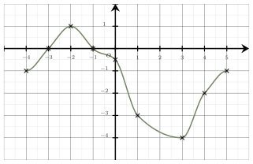
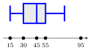
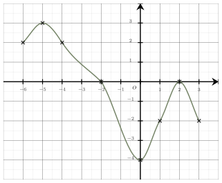
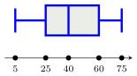


On considère la fonction $f$ définie sur $\mathbb{R}$ par $f(x)=(-4x+24)(8x+56)$.

Dresser le tableau de signes de $f$.
---CORR---
L'équation $-4x+24=0$ a pour solution $x=6$.

L'équation $8x+56=0$ a pour solution $x=-7$.

Le tableau de signe du produit $(-4x+24)(8x+56)$ est :




On considère une fonction $f$ dont la représentation graphique $\mathscr{C}$ est tracée ci-dessous.

Lire l'image de $-3$ par $f$.
---CORR---
Les images se lisent sur l'axe des ordonnées et les antécédents sur l'axe des abscisses.

Ainsi, on peut dire que :

$\bullet$ $0$ est l'image de $-3$,

$\bullet$ un antécédent de $0$ est $-3$,

$\bullet$ $-3$ est un antécédent de $0$,

$\bullet$ **l'image de $-3$ est $0$**,

$\bullet$ $-3$ a pour image $0$,

$\bullet$ $0$ a pour antécédent $-3$.



Une grandeur passe de $600$ à $900$.

Quel est son taux d'évolution, en pourcentage ?
---CORR---
Le taux d'évolution $t$ est donné par la formule :

$t = \dfrac{\text{valeur finale} - \text{valeur initiale}}{\text{valeur initiale}}$

Ici :
$t=\dfrac{900 - 600}{600}  = 0{,}5$

Le taux d'évolution est donc de $50 \ $%.



Une série statistique est résumée par le diagramme en boîte ci-dessous.

Donner l'écart interquartile de cette série.
---CORR---
L'écart interquartile est la différence entre le troisième quartile et le premier quartile.

D'après le diagramme en boite, on a $Q_3 = 55$ et $Q_1 = 30$.

Donc l'écart interquartile est $Q_3 - Q_1 = 55 - 30 = 25$.



Dans un lycée, la moitié des élèves sont internes. Parmi eux, trois cinquièmes sont des filles.

Quelle est la proportion de filles internes par rapport à l'ensemble des élèves du lycée ?
---CORR---
La proportion des filles internes par rapport à l'ensemble des élèves du lycée est donnée par :

$\dfrac{1}{2}\times \dfrac{3}{5}=\dfrac{3}{10}$.



Soit $n$ un entier.

Écrire $\left(4^n\right)^{2}$ sous la forme $a^n$, où $a$ est un entier.
---CORR---
On applique la propriété des puissances de puissances d'un réel :

Soit $n\in \mathbb{N}$, et $p \in \mathbb{N}$, on a :
$\left(a^{n}\right)^{p}=a^{np}$

$\begin{aligned}\left(4^{n}\right)^{2}&=4^{2n}\\
&=\left(4^{2}\right)^{n}\\
&=16^{n}
\end{aligned}$



On considère la fonction $f$ définie sur $\mathbb{R}$ par $f(x)=(5x-20)(-5x+5)$.

Dresser le tableau de signes de $f$.
---CORR---
L'équation $5x-20=0$ a pour solution $x=4$. 
L'équation $-5x+5=0$ a pour solution $x=1$. 
Le tableau de signe du produit $(5x-20)(-5x+5)$ est :  




On considère une fonction $f$ dont la représentation graphique $\mathscr{C}$ est tracée ci-dessous.

Lire un antécédent de $3$ par $f$.
---CORR---
Les images se lisent sur l'axe des ordonnées et les antécédents sur l'axe des abscisses. 
Ainsi, on peut dire que : 
$\bullet$ $3$ est l'image de $-5$, 
$\bullet$ un antécédent de $3$ est $-5$,  
$\bullet$ $-5$ est un antécédent de $3$, 
$\bullet$ l'image de $-5$ est $3$, 
$\bullet$ $-5$ a pour image $3$,  
$\bullet$ $3$ a pour antécédent $-5$.



Une grandeur passe de $300$ à $600$.

Quel est son taux d'évolution, en pourcentage ?
---CORR---
Le taux d'évolution $t$ est donné par la formule : 
$t = \dfrac{\text{valeur finale} - \text{valeur initiale}}{\text{valeur initiale}}$

Ici :
$t=\dfrac{600 - 300}{300}  = 1$ 
Le taux d'évolution est donc de $\boldsymbol{100} \,\%$.



Une série statistique est résumée par le diagramme en boîte ci-dessous.

Donner l'écart interquartile de cette série.
---CORR---
L'écart interquartile est la différence entre le troisième quartile et le premier quartile. 
D'après le diagramme en boite, on a $Q_3 = 60$ et $Q_1 = 25$. 
Donc l'écart interquartile est $Q_3 - Q_1 = 60 - 25 = \boldsymbol{35}$.



Dans un lycée, un cinquième des élèves sont internes. Parmi eux, un quart sont des filles.

Quelle est la proportion de filles internes par rapport à l'ensemble des élèves du lycée ? Donner le résultat en pourcentage.
---CORR---
La proportion des filles internes par rapport à l'ensemble des élèves du lycée est donnée par :  
$\dfrac{1}{5}\times \dfrac{1}{4}=\dfrac{1}{20}=\dfrac{5}{100}$, soit $\boldsymbol{5\,\%}$.



Soit $n$ un entier.

Écrire $\left(4^n\right)^{2}$ sous la forme $a^n$, où $a$ est un entier.
---CORR---
On applique la propriété des puissances de puissances d'un réel :  
Soit $n\in \mathbb{N}$, et $p \in \mathbb{N}$, on a :
$\left(a^{n}\right)^{p}=a^{np}$ 

$$
\begin{aligned}\left(4^{n}\right)^{2}&=4^{2n}\\
&=\left(4^{2}\right)^{n}\\
&=\boldsymbol{16^{n}}
\end{aligned}
$$


