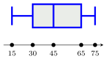
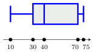


Le prix d'un article est passé de $100$ euros à $90$ euros.

Par quel nombre ce prix a-t-il été multiplié ?
---CORR---
**Méthode 1 :**

On cherche le nombre $k$ tel que $ k \times 100=90 $.

On obtient $k=\dfrac{90}{100} = \dfrac{9}{10}=0{,}9$.

**Méthode 2 :**

Le prix a diminué de $10$ euros, ce qui représente $10\ $% de $100$ euros.

Le coefficient multiplicateur associé à cette baisse est $0{,}9$.

On peut dire que le prix a été multiplié par $0{,}9$.



Une série statistique est résumée par le diagramme en boîte ci-dessous.

Quel pourcentage des valeurs est compris entre $15$ et $75$ ?
---CORR---
La valeur $15$ correspond au minimum et la valeur $75$ au maximum.

Donc, la proportion de valeurs comprises entre $15$ et $75$ est de $100$%.



On considère l'équation $(4x+12)(4x+20)=0$.

Calculer la somme de ses solutions.
---CORR---
On reconnaît une équation produit nul.

Un produit de facteurs est nul, si et seulement si l'un au moins de ses facteurs est nul.

$\begin{aligned}
(4x+12)(4x+20)&=0\\
4x+12=0 &\text{ ou } 4x+20=0\\
4x=-12 &\text{ ou } 4x=-20\\
x=-3 &\text{ ou } x=-5
\end{aligned}$

La somme de ces solutions est donc égale à : $(-3)+(-5)=\boldsymbol{-8}$.



On considère la fonction $f$ définie sur $\mathbb{R}$ par $f(x)=7-\dfrac{6}{5}(x-2)^2$.

Calculer l'image de $2$ par $f$.
---CORR---
$\begin{aligned}
f\left(2\right)&=7-\dfrac{6}{5}(2-2)^2\\
&=7-\dfrac{6}{5}\times 0\\
&=7
\end{aligned}$

L'image de $2$ par la fonction $f$ est : $7$.



Donner la médiane de la série statistique suivante :

$$7\ ;\ 10\ ;\ 18\ ;\ 5\ ;\ 14\ ;\ 8\ ;\ 16\ ;\ 19\ ;\ 12\ ;\ 13$$
---CORR---
La série triée dans l'ordre croissant est : $5$ ; $7$ ; $8$ ; $10$ ; $12$ ; $13$ ; $14$ ; $16$ ; $18$ ; $19$.

La série comporte $10$ valeurs, qui est un nombre pair, donc une médiane est une valeur **strictement** comprise entre les termes de rang $5$ et $6$,
soit entre $12$ et $13$.

Prenons la moyenne de ces deux valeurs :

$\dfrac{12 + 13}{2} = 12{,}5$.

La médiane est donc $12{,}5$.



On considère $A=\dfrac{5}{10\ 000}+\dfrac{5}{100}$.

Donner l'écriture décimale de $A$.
---CORR---
On a :

$\begin{aligned}
A&=\dfrac{5}{10\ 000}+\dfrac{5}{100}\\
&=0{,}000\ 5+0{,}05\\
&=0{,}050\ 5
\end{aligned}$



Le prix d'un article est passé de $68$ euros à $85$ euros.

Par quel nombre ce prix a-t-il été multiplié ?
---CORR---
**Méthode 1 :** 
On cherche le nombre $k$ tel que $ k \times 68=85 $. 
On obtient $k=\dfrac{85}{68} = \dfrac{5}{4}=\boldsymbol{1{,}25}$.

**Méthode 2 :** 
Le prix a augmenté de $17$ euros, ce qui représente $25\,\%$ de $68$ euros. 
Le coefficient multiplicateur associé à cette hausse est $1{,}25$. 
On peut dire que le prix a été multiplié par $\boldsymbol{1{,}25}$.



Une série statistique est résumée par le diagramme en boîte ci-dessous.

Quel pourcentage des valeurs est compris entre $30$ et $75$ ?
---CORR---
La valeur $30$ correspond au premier quartile et la valeur $75$ au maximum. 
Donc, la proportion de valeurs comprises entre $30$ et $75$ est de $75\%$.



On considère l'équation $(2x-12)(5x-25)=0$.

Calculer le produit de ses solutions.
---CORR---
On reconnaît une équation produit nul.  
Un produit de facteurs est nul, si et seulement si l'un au moins de ses facteurs est nul. 

$$
\begin{aligned}
(2x-12)(5x-25)&=0\\
2x-12=0 &\text{ ou } 5x-25=0\\
2x=12 &\text{ ou } 5x=25\\
x=6 &\text{ ou } x=5
\end{aligned}
$$

Le produit de ces solutions est donc égal à : $6\times 5=\boldsymbol{30}$.



On considère la fonction $f$ définie sur $\mathbb{R}$ par $f(x)=3-\dfrac{2}{3}(x-5)^2$.

Calculer l'image de $6$ par $f$.
---CORR---
$$
\begin{aligned}
f\left(6\right)&=3-\dfrac{2}{3}(6-5)^2\\
&=3-\dfrac{2}{3}\times 1\\
&=\dfrac{7}{3}
\end{aligned}
$$

L'image de $6$  par la  fonction  $f$ est : $\boldsymbol{\dfrac{7}{3}}$.



Donner la médiane de la série statistique suivante :

$$17\ ;\ 11\ ;\ 5\ ;\ 14\ ;\ 8$$
---CORR---
La série triée dans l'ordre croissant est : $5$  ;  $8$  ;  $11$  ;  $14$  ;  $17$. 
La série comporte $5$ valeurs, qui est un nombre impair,  donc la médiane est le terme de rang $3$. 
La médiane est donc $11$.



On considère $A=\dfrac{5}{10}+\dfrac{5}{100}$.

Donner l'écriture décimale de $A$.
---CORR---
On a  :  

$$
\begin{aligned}
A&=\dfrac{5}{10}+\dfrac{5}{100}\\
&=0{,}5+0{,}05\\
&=\boldsymbol{0{,}55}
\end{aligned}
$$


