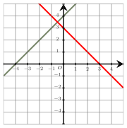
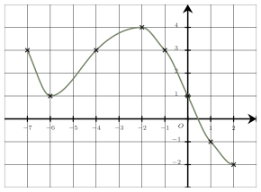
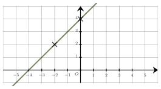
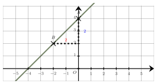
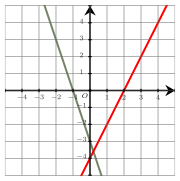
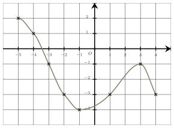
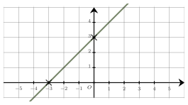
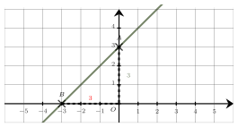


On additionne un nombre réel $x$ avec son triple, puis on élève le résultat au carré.

Exprimer le résultat en fonction de $x$.
---CORR---
On additionne d'abord $x$ avec son triple $3x$ : $x + 3x = 4x$.

Puis on élève le résultat au carré : $\boldsymbol{(4x)^2}$.



Une fonction affine $f$, de coefficient directeur $3$, a le tableau de signes ci-dessous.

Donner l'expression de $f(x)$.
---CORR---
D'après le tableau de signes, la fonction $f$ s'annule en $1$.

Comme $f$ est affine de coefficient directeur $3$, on a $f(x)=3x+p$, et $f(1)=0$ donne $3\times 1+p=0$, soit $p=-3$.

On vérifie que le coefficient directeur $3$ est bien positif : $f$ est négative puis positive, comme dans le tableau.

Ainsi $\boldsymbol{f(x)=3x-3}$.



Résoudre dans $\mathbb{R}$ l'équation $2x^2+3x-5=-5$.
---CORR---
L'équation $2x^2+3x-5=-5$ s'écrit $2x^2+3x=0$.

En factorisant le premier membre (facteur commun $x$), on obtient $x(2x+3)=0$.

On reconnaît une équation produit nul dont les solutions sont : $0$ et $\dfrac{-3}{2}=-\dfrac{3}{2}$.

$\mathscr{S}=\boldsymbol{\lbrace 0;-\dfrac{3}{2}\rbrace}$



On donne les représentations graphiques de deux fonctions affines $g$ (en vert) et $h$ (en rouge) définies sur $\mathbb{R}$.

Dresser le tableau de signes de la fonction $f$ définie sur $\mathbb{R}$ par $f(x)=g(x)\times h(x)$.
---CORR---
La fonction $g$ s'annule en $-4$ et la fonction $h$ s'annule en $3$.

Quand la droite est en-dessous de l'axe des abscisses, la fonction est négative et quand elle est au-dessus, la fonction est positive.

On en déduit le tableau de signes de leur produit :



On donne la représentation graphique d'une fonction $f$.

Combien de solutions l'équation $f(x)=3$ admet-elle ?
---CORR---
Le nombre de solutions de l'équation $f(x)=3$ est le nombre d'antécédents de $3$ par la fonction $f$.

Puisque la droite d'équation $y = 3$ (droite hrizontale) coupe $3$ fois la courbe, on en déduit que l'équation $f(x)=3$ admet $\boldsymbol{3}$ **solutions**.



Donner l'équation réduite de la droite ci-dessous.

---CORR---
Le coefficient directeur $m$ de la droite $(AB)$ est donné par :

$m=\dfrac{\boldsymbol{2}}{\boldsymbol{2}}=1$.  
Son ordonnée à l'origine est $4$, ainsi l'équation réduite de la droite est $\boldsymbol{y=x+4}$.




On additionne un nombre réel $x$, son double et son carré.

Exprimer le résultat en fonction de $x$.
---CORR---
On additionne un nombre réel $x$, avec son double $2x$ et son carré $x^2$. 
On obtient : $x + 2x + x^2 = \boldsymbol{3x + x^2}$.



Une fonction affine $f$, de coefficient directeur $1$, a le tableau de signes ci-dessous.

Donner l'expression de $f(x)$.
---CORR---
D'après le tableau de signes, la fonction $f$ s'annule en $2$. 
Comme $f$ est affine de coefficient directeur $1$, on a $f(x)=x+p$, et $f(2)=0$ donne $2+p=0$, soit $p=-2$. 
On vérifie que le coefficient directeur $1$ est bien positif : $f$ est négative puis positive, comme dans le tableau. 
Ainsi $\boldsymbol{f(x)=x-2}$.



Résoudre dans $\mathbb{R}$ l'équation $-7x^2-3x-8=-8$.
---CORR---
L'équation $-7x^2-3x-8=-8$ s'écrit $-7x^2-3x=0$. 
En factorisant le premier membre (facteur commun $x$), on obtient $x(-7x-3)=0$. 
On reconnaît une équation produit nul dont les solutions sont : $0$ et $\dfrac{3}{-7}=-\dfrac{3}{7}$. 
$\mathcal{S}=\boldsymbol{\{0;-\dfrac{3}{7}\}}$



On donne les représentations graphiques de deux fonctions affines $g$ (en vert) et $h$ (en rouge) définies sur $\mathbb{R}$.

Dresser le tableau de signes de la fonction $f$ définie sur $\mathbb{R}$ par $f(x)=g(x)\times h(x)$.
---CORR---
La fonction $g$ s'annule en $-1$ et la fonction $h$ s'annule en $2$. 
Quand la droite est en-dessous de l'axe des abscisses, la fonction est négative et quand elle est au-dessus, la fonction est positive. 
On en déduit le tableau de signes de leur produit :




On donne la représentation graphique d'une fonction $f$.

Combien de solutions l'équation $f(x)=2$ admet-elle ?
---CORR---
Le nombre de solutions de  l'équation $f(x)=2$ est le nombre d'antécédents de  $2$ par la fonction $f$. 
Puisque la droite d'équation $y = 2$ (droite hrizontale) coupe $1$ fois la courbe, on en déduit que l'équation  $f(x)=2$ admet $\boldsymbol{1}$ solution..



Donner l'équation réduite de la droite ci-dessous.

---CORR---
Le coefficient directeur $m$ de la droite $(AB)$ est donné par :  
$m=\dfrac{\boldsymbol{3}}{\boldsymbol{3}}=\dfrac{1\boldsymbol{\times3} }{1\boldsymbol{\times3}}=1$. 
Son ordonnée à l'origine est $3$, ainsi l'équation réduite de la droite est $\boldsymbol{y=x+3}$. 



