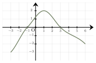
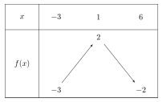
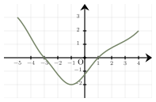
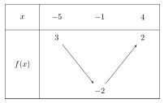


Écrire, en fonction de $x$, le produit de $3$ par la somme de $x$ et de $6$.
---CORR---
Le produit de $3$ par la somme de $x$ et de $6$ s'écrit : $\boldsymbol{(x+6)\times 3}$.



Le degré Fahrenheit $F$ est une unité de mesure de la température utilisée aux États-Unis. Il est lié au degré Celsius $C$ par la formule :

$$F=\dfrac{9}{5}C+32$$

Exprimer $C$ en fonction de $F$.
---CORR---
On part de la formule : $F = \dfrac{9}{5}C + 32$.

En isolant $C$, on obtient : $F - 32 = \dfrac{9}{5}C$.

En multipliant les deux membres par $\dfrac{5}{9}$, on obtient : $\boldsymbol{C = \dfrac{5}{9}(F - 32)}$.



Soit $f$ la fonction définie sur $[-3\ ;\ 6]$ représentée ci-dessous.

Dresser le tableau de variations de $f$.
---CORR---
La fonction $f$ est définie sur $[-3\ ;\ 6]$.

La fonction est croissante puis décroissante.

Elle atteint un maximum en $x=1$.




On considère la fonction $f$ définie sur $\mathbb{R}$ par $f(x)=-2x^2-4x-1$.

Calculer l'image de $-\dfrac{3}{5}$ par $f$.
---CORR---
On remplace $x$ par $-\dfrac{3}{5}$ dans l'expression de $f$ :

$\begin{aligned}
f\left(-\dfrac{3}{5}\right)&=-2\times \left(-\dfrac{3}{5}\right)^2-4\times \left(-\dfrac{3}{5}\right)-1\\
&=-2\times\dfrac{9}{25}+\dfrac{12}{5}-1\\
&=-\dfrac{18}{25}+\dfrac{12}{5}-1\\
&=\dfrac{-18+60-25}{25}\\
&=\dfrac{17}{25}
\end{aligned}$

L'image de $-\dfrac{3}{5}$ par la fonction $f$ est : $\boldsymbol{\dfrac{17}{25}}$.



Soient $a$ et $b$ deux réels non nuls.

Écrire $a^4\times b^4$ sous la forme d'une seule puissance.
---CORR---
Les deux exposants sont égaux, ainsi :
$\begin{aligned}
a^4\times b^4&=\boldsymbol{\left(ab\right)^4}\end{aligned}$



$p\ $% de $20$ est égal à $18$.

Déterminer $p$.
---CORR---
Prendre $10\ $% d'une quantité revient à la diviser par $10$.

$10\ $% de $20$ est égal à $2$.

En multipliant par $9$, on obtient :  $90\ $% de $20$ est égal à $18$.

Ainsi $p=\boldsymbol{90}$.



Écrire, en fonction de $x$, le produit de $9$ par la somme de $x$ et de $8$.
---CORR---
Le produit de $9$ par la somme de $x$ et de $8$ s'écrit : $\boldsymbol{9(x+8)}$.



L'aire $A$ d'un trapèze de petite base $b$, de grande base $B$ et de hauteur $h$ est donnée par :

$$A=\dfrac{(b+B)\times h}{2}$$

Exprimer $h$ en fonction de $A$, $b$ et $B$.
---CORR---
On part de la formule : $A = \dfrac{(b + B) \times h}{2}$. 
En multipliant les deux membres par $2$, on obtient : $2A = (b + B) \times h$. 
En isolant $h$, on obtient : $\boldsymbol{h = \dfrac{2A}{b + B}}$.



Soit $f$ la fonction définie sur $[-5\ ;\ 4]$ représentée ci-dessous.

Dresser le tableau de variations de $f$.
---CORR---
La fonction $f$ est définie sur $[-5\,;\,4]$. 
La fonction est décroissante puis croissante. 
Elle atteint un minimum en $x=-1$. 




On considère la fonction $f$ définie sur $\mathbb{R}$ par $f(x)=-2x^2+3x-2$.

Calculer l'image de $-\dfrac{6}{5}$ par $f$.
---CORR---
On remplace $x$ par $-\dfrac{6}{5}$ dans l'expression de $f$ : 

$$
\begin{aligned}
f\left(-\dfrac{6}{5}\right)&=-2\times \left(-\dfrac{6}{5}\right)^2+3\times \left(-\dfrac{6}{5}\right)-2\\
&=-2\times\dfrac{36}{25}-\dfrac{18}{5}-2\\
&=-\dfrac{72}{25}-\dfrac{18}{5}-2\\
&=\dfrac{-72-90-50}{25}\\
&=-\dfrac{212}{25}
\end{aligned}
$$

L'image de $-\dfrac{6}{5}$ par la fonction $f$ est : $\boldsymbol{-\dfrac{212}{25}}$.



Soient $a$ et $b$ deux réels non nuls.

Écrire $a^3\times b^3$ sous la forme d'une seule puissance.
---CORR---
Les deux exposants sont égaux, ainsi :  

$$
\begin{aligned}
a^3\times b^3&=\boldsymbol{\left(ab\right)^3}\end{aligned}
$$



$p\ $% de $60$ est égal à $3$.

Déterminer $p$.
---CORR---
Prendre $10\,\%$ d'une quantité revient à la diviser par $10$. 
$10\,\%$ de $60$ est égal à $6$. 
En divisant par $2$, on obtient :  
$5\,\%$  de $60$ est égal à $3$. 
Ainsi $p=\boldsymbol{5}$.


