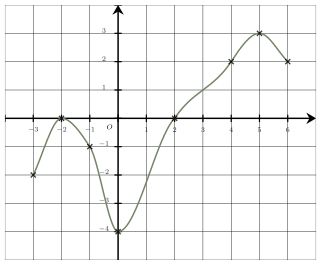


Voici la représentation graphique d'une fonction $f$ définie sur $[-3\ ;\ 6]$.

Quel est le minimum de $f$ sur $[-3\ ;\ 6]$ ?
---CORR---
Le minimum de $f$ est l'ordonnée du point le plus bas de la courbe.

Le point le plus bas de la courbe a pour ordonnée $-4$.

Le minimum de $f$ est donc $\boldsymbol{-4}$.



Ranger dans l'ordre croissant les trois nombres suivants :

$$A=0{,}375\qquad B=\dfrac{38}{100}\qquad C=\dfrac{7}{20}$$
---CORR---
Pour comparer ces trois nombres, on les écrit sous forme décimale :
$A = 0,375$ 

$B = \dfrac{38}{100} = 0,38$  

$C = \dfrac{7}{20} = \dfrac{7 \times 5}{20\times 5} = \dfrac{35}{100}=0,35$  

On a donc : $0,35 < 0,375 < 0,38$.
Finalement : $\boldsymbol{C < A < B}$.



Simplifier $3a\times 1-a$.
---CORR---
Tout nombre multiplié par $1$ est égal à lui-même : $3a\times 1=3a$.

$3a\times 1-a=3a-a=\boldsymbol{2a}$



Résoudre dans $\mathbb{R}$ l'inéquation $-3(x+7)(x-2)>0$.
---CORR---
$(x+7)(x-2)$ est un produit de deux fonctions affines.

L'équation $x+7=0$ a pour solution $x=-7$.

L'équation $x-2=0$ a pour solution $x=2$.

Le tableau de signe du produit $-3(x+7)(x-2)$ est :

On en déduit que l'ensemble des solutions est $\boldsymbol{]-7\ ;\ 2[}.$



Soit $h$ la fonction définie par $h(x)=-6x+3$.

Calculer $h(-3)+h(1)$.
---CORR---
On a : $h(-3)=-6\times (-3)+3=21$ et $h(1)=-6\times 1+3=-3$.  

On en déduit que $h(-3)+h(1)=21-3=\boldsymbol{18}$.



Donner le premier quartile de la série statistique suivante :

$$5\ ;\ 17\ ;\ 14\ ;\ 6\ ;\ 20\ ;\ 23\ ;\ 8\ ;\ 16\ ;\ 15$$
---CORR---
La série triée par ordre croissant est : $5$ ; $6$ ; $8$ ; $14$ ; $15$ ; $16$ ; $17$ ; $20$ ; $23$.  
La série contient $9$ valeurs.  

Pour trouver le rang de $Q_1$, on calcule le quart de 9 qui vaut
$\dfrac{9}{4}=2{,}25$  
On arrondit à l'entier supérieur qui vaut $3$.  
Le premier quartile est donc la valeur de rang $3$ de la série classée : $Q_1=8$.



---Q---
Voici la représentation graphique d'une fonction $f$ définie sur $[-3\ ;\ 6]$.

Une seule affirmation est correcte :

- Le maximum de $f$ est $6$.
- $f(-0{,}2) \times f(-1{,}3) < 0$
- L'inéquation $f(x) \leqslant 0$ a pour ensemble de solutions $[-3\ ;\ -2[\cup]-2\ ;\ 2]$.
- $f$ est positive sur $[3{,}3\ ;\ 5{,}9]$

---CORR---
$\bullet$ $f$ est positive sur $[3{,}3\,;\,5{,}9]$ 
Cette affirmation est correcte :  
$f$ est positive sur $[3{,}3\,;\,5{,}9]$ car la courbe se situe au-dessus de l'axe des abscisses sur cet intervalle. 
$\bullet$ L'inéquation $f(x) \leqslant 0$ a pour ensemble de solutions $[-3\,;\,-2[\cup]-2\,;\,2]$. 
Cette affirmation est fausse :  
Les solutions de l'inéquation $f(x) \leqslant 0$ sont les abscisses des points de la courbe situés en dessous ou sur l'axe des abscissses. 
$\bullet$ Le maximum de $f$ est $6$. 
Cette affirmation est fausse :  
Le point le plus haut de la courbe a pour ordonnée $3$. C'est le maximum de $f$. 
$\bullet$ $f(-0{,}2) \times f(-1{,}3) < 0$ 
Cette affirmation est fausse :  
$f(-0{,}2) <0$ et  $f(-1{,}3) < 0$, donc le produit est positif.

La bonne réponse est la réponse D.



Ranger dans l'ordre croissant les trois nombres suivants :

$$A=\dfrac{6}{10}\qquad B=\dfrac{31}{50}\qquad C=0{,}59$$
---CORR---
Pour comparer ces trois nombres, on les écrit sous forme décimale : 
$A = \dfrac{6}{10} = 0,6$

$B = \dfrac{31}{50} = \dfrac{31 \times 2}{50\times 2} =  \dfrac{62}{100}=0,62$

$C = 0,59$

On a donc : $0,59 < 0,6 < 0,62$. 
Finalement : $\boldsymbol{C < A < B}$.



Simplifier $0\times a$.
---CORR---
Tout nombre multiplié par $0$ est égal à $0$. 
$0 \times a = \boldsymbol{0}$



Résoudre dans $\mathbb{R}$ l'inéquation $9(x-6)(x+9)<0$.
---CORR---
$(x-6)(x+9)$ est un produit de deux fonctions affines. 
L'équation $x-6=0$ a pour solution $x=6$. 
L'équation $x+9=0$ a pour solution $x=-9$. 
Le tableau de signe du produit  $9(x-6)(x+9)$ est :  

On en déduit que l'ensemble des solutions est $\boldsymbol{]-9\,;\,6[}.$



Soit $k$ la fonction définie par $k(x)=6x-5$.

Calculer $k(0)+k(3)$.
---CORR---
On a : $k(0)=6\times 0-5=-5$ et $k(3)=6\times 3-5=13$. 
On en déduit que $k(0)+k(3)=-5+13=\boldsymbol{8}$.



Donner le premier quartile de la série statistique suivante :

$$28\ ;\ 9\ ;\ 20\ ;\ 12\ ;\ 13$$
---CORR---
La série triée par ordre croissant est : $9$  ;  $12$  ;  $13$  ;  $20$  ;  $28$. 
La série contient $5$ valeurs. 
Pour trouver le rang de $Q_1$, on calcule le quart de 5 qui vaut
$\dfrac{5}{4}=1{,}25$ 
On arrondit à l'entier supérieur qui vaut $2$. 
Le premier quartile est donc la valeur de rang $2$ de la série classée : $Q_1=12$.


