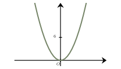
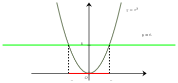
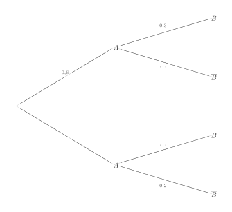
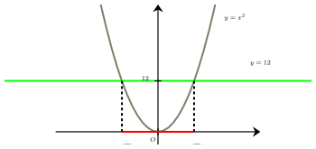


Soit $a$ un réel non nul et $n$ un entier non nul.

Écrire $\dfrac{a^{n}}{a^{n^{3}}}$ sous la forme d'une puissance de $a$.
---CORR---
On applique la propriété du quotient des puissances d'un réel :

Soit $n$ et $p$ deux entiers et $a$ un réel : $\dfrac{a^n}{a^p}=a^{n-p}$

$\begin{aligned} \dfrac{a^{n}}{a^{n^{3}}}&=a^{n-n^{3}}\\
&=a^{-n(-1+n^{2})}\\
&=\boldsymbol{a^{-n(n^{2}-1)}}
\end{aligned}$



On a représenté la parabole d'équation $y=x^2$.

Résoudre dans $\mathbb{R}$ l'inéquation $x^2\leqslant 6$.
---CORR---
Pour résoudre graphiquement cette inéquation :

$\bullet$ On trace la parabole d'équation $y=x^2$.

$\bullet$ On trace la droite horizontale d'équation $y=6$. Cette droite coupe la parabole en $-\sqrt{6}$ et $\sqrt{6}$.

$\bullet$ Les solutions de l'inéquation sont les abscisses des points de la courbe qui se situent sur ou sous la droite.

On en déduit que l'ensemble des solutions de l'inéquation est : $S = [-\sqrt{6}\ ;\ \sqrt{6}]$.



Un prix augmente de $25\ $% puis baisse de $25\ $%. On sait que le taux réciproque d'une augmentation de $25\ $% est une baisse de $20\ $%.

Après ces deux évolutions, le prix est-il inférieur, égal ou supérieur à sa valeur de départ ?
---CORR---
Le taux réciproque d'une augmentation de $25\ $% est une baisse de $20\ $%.

Comme $25\ $%$ > 20\ $%, la baisse appliquée est plus forte que celle nécessaire pour retrouver le prix initial.

**Le prix final sera donc strictement inférieur au prix initial.**



$(D)$ et $(D')$ sont deux droites d'équations réduites $y=-3x+5$ et $y=x-2$.

Sur quel intervalle la droite $(D)$ est-elle strictement au-dessus de la droite $(D')$ ?
---CORR---
La droite $(D)$ est strictement au-dessus de la droite $(D')$ lorsque $-3x+5>x-2$.

$\begin{aligned}
-3x+5&>x-2\\
-4x&>-7\\
x&<\dfrac{7}{4}
\end{aligned}$

La droite $(D)$ est donc strictement au-dessus de la droite $(D')$ sur :
$\boldsymbol{\left]-\infty\ ;\ \dfrac{7}{4}\right[}$.



On considère l'arbre de probabilités ci-dessous.

Calculer $p(B)$.
---CORR---
Comme $A$ et $\overline A$ fonrment une partition de l'univers, on applique la formule de probabilité totale :

$\begin{aligned}
p(B)&=p(A)\times p_A(B)+p(\overline A)\times p_{\overline A}(B)\\
&=0{,}6\times 0{,}3+0{,}4\times 0{,}8\\
&=\boldsymbol{0{,}5}.
\end{aligned}$



Un appareil a besoin d'une énergie de $16{,}56\times 10^{6}$ joules (J) pour se mettre en route.

Convertir cette énergie en kilowattheures (kWh), sachant que $1\text{ kWh}=3{,}6\times 10^{6}\text{ J}$.
---CORR---
Pour convertir des Joules en kWh, on utilise la relation donnée : 

$1 \text{ kWh} = 3,6 \times 10^{6}\text{ J}$ 

L'énergie en Joules est : $E = 16{,}56 \times 10^{6} \text{ J}$ 

Pour trouver l'énergie en kWh, on divise par $3,6 \times 10^{6}$ : 

$E_{\text{kWh}} = \dfrac{16{,}56 \times 10^{6}}{3,6 \times 10^{6}} = \dfrac{16{,}56}{3,6} = 4{,}6~\text{kWh}$ 

Sans calculatrice, on peut estimer la valeur en approchant $16{,}56$ par $17$ et $3,6$ par $4$. 

On obtient alors : $\dfrac{17}{4} = 4{,}25$, ce qui nous indique que le résultat est proche de $4{,}25$. 

L'énergie nécessaire est donc de $\boldsymbol{4{,}6}$ $\text{kWh}$.



Soit $a$ un réel non nul et $n$ un entier non nul.

Écrire $\dfrac{a^{n^{2}}}{a^{n}}$ sous la forme d'une puissance de $a$.
---CORR---
On applique la propriété du quotient des puissances d'un réel :  
Soit $n$ et $p$ deux entiers et $a$ un réel :  $\dfrac{a^n}{a^p}=a^{n-p}$ 

$$
\begin{aligned} \dfrac{a^{n^{2}}}{a^{n}}&=a^{n^{2}-n}\\
&=\boldsymbol{a^{n(n^{}-1)}}
\end{aligned}
$$



On a représenté la parabole d'équation $y=x^2$.

Résoudre dans $\mathbb{R}$ l'inéquation $x^2\leqslant 12$.
---CORR---
Pour résoudre graphiquement cette inéquation :  
$\bullet$ On trace la parabole d'équation $y=x^2$.  
$\bullet$ On trace la droite horizontale d'équation $y=12$. Cette droite coupe la parabole en $-\sqrt{12}$ et $\sqrt{12}$.  
$\bullet$ Les solutions de l'inéquation sont les abscisses des points de la courbe qui se situent  sur ou sous  la droite. 

On en déduit que l'ensemble des solutions de l'inéquation est : $S = [-\sqrt{12}\,;\,\sqrt{12}]$.



Un prix diminue de $20\ $% puis augmente de $30\ $%. On sait que le taux réciproque d'une baisse de $20\ $% est une augmentation de $25\ $%.

Après ces deux évolutions, le prix est-il inférieur, égal ou supérieur à sa valeur de départ ?
---CORR---
Le taux réciproque d'une baisse de $20\,\%$ est une augmentation de $25\,\%$. 
Comme $30\,\% > 25\,\%$, l'augmentation appliquée est plus forte que celle nécessaire pour retrouver le prix initial. 
Le prix final sera donc strictement supérieur au prix initial.



$(D)$ et $(D')$ sont deux droites d'équations réduites $y=4x-3$ et $y=-9x+4$.

Sur quel intervalle la droite $(D)$ est-elle strictement au-dessus de la droite $(D')$ ?
---CORR---
La droite $(D)$ est strictement au-dessus de la droite $(D')$ lorsque $4x-3>-9x+4$. 

$$
\begin{aligned}
4x-3&>-9x+4\\
13x&>7\\
x&>\dfrac{7}{13}
\end{aligned}
$$

La droite $(D)$ est donc strictement au-dessus de la droite $(D')$ sur :
$\boldsymbol{\left]\dfrac{7}{13}\,;\, +\infty\right[}$.



On considère l'arbre de probabilités ci-dessous.

Calculer $p(B)$.
---CORR---
On applique la formule de probabilité totale : 

$$
\begin{aligned}
p(B)&=p(A)\times p_A(B)+p(\overline A)\times p_{\overline A}(B)\\
&=0{,}9\times 0{,}6+0{,}1\times 0{,}9\\
&=\boldsymbol{0{,}63}.
\end{aligned}
$$



Un appareil a besoin d'une énergie de $6{,}12\times 10^{6}$ joules (J) pour se mettre en route.

Convertir cette énergie en kilowattheures (kWh), sachant que $1\text{ kWh}=3{,}6\times 10^{6}\text{ J}$.
---CORR---
Pour convertir des Joules en kWh, on utilise la relation donnée : 
$1~\text{kWh} = 3,6 \times 10^{6}~\text{J}$ 
L'énergie en Joules est : $E = 6{,}12 \times 10^{6}~\text{J}$ 
Pour trouver l'énergie en kWh, on divise par $3,6 \times 10^{6}$ : 
$E_{\text{kWh}} = \dfrac{6{,}12 \times 10^{6}}{3,6 \times 10^{6}} = \dfrac{6{,}12}{3,6} = 1{,}7~\text{kWh}$ 
Sans calculatrice, on peut estimer la valeur en approchant $6{,}12$ par $6$ et $3,6$ par $4$. 
On obtient alors : $\dfrac{6}{4} = 1{,}5$, ce qui nous indique que le résultat est proche de $1{,}5$. 
L'énergie nécessaire est donc de $\boldsymbol{1{,}7}$ $\text{kWh}$.


