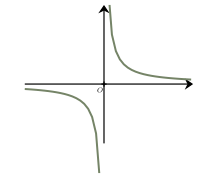
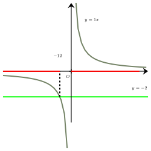
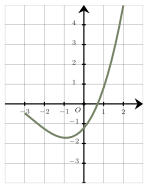
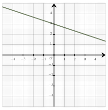
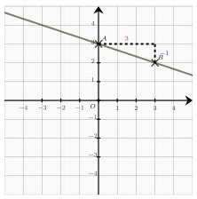
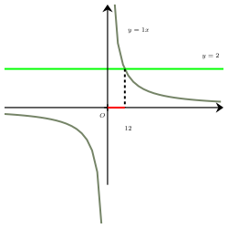
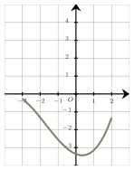
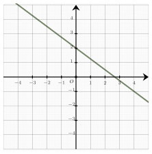
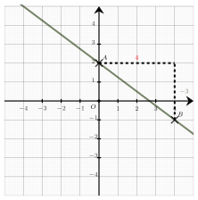


Le prix d'une maison est $229\ 500\ $€. Le vendeur propose une remise de $500\ $€.

Donner un ordre de grandeur du pourcentage de remise.
---CORR---
Pour déterminer un ordre de grandeur, on cherche à comparer la remise avec des pourcentages simples du prix initial.

Les pourcentages de référence les plus utiles sont $1\ $% et $10\ $% car ils sont faciles à calculer mentalement.

La remise ($500\ $€) est très petite par rapport au prix.

On prend $1\ $% de $229\ 500\ $€. Cela revient à diviser par $100$.

On obtient $2\ 295\ $€.

On remarque que la remise est environ $10$ fois plus petite que $1\ $% du prix.

Un ordre de grandeur du pourcentage de remise est donc $\boldsymbol{0{,}1\ \%}$.



Le prix d'un article a diminué de $15\ $%.

Par quelle fraction irréductible faut-il multiplier son prix actuel pour retrouver son prix avant la réduction ?
---CORR---
Diminuer de $15~$% revient à multiplier par $1-\dfrac{15}{100}=0{,}85$.

Pour retrouver le prix initial, il faut diviser par ce coefficient, c'est-à-dire multiplier par le coefficient multiplicateur réciproque $\dfrac{1}{0{,}85}$.

En multipliant par $100$ le numérateur et le dénominateur, on a $\dfrac{1}{0{,}85}=\dfrac{100}{85}$, puis en simplifiant par $5$, on obtient $\dfrac{100}{85}=\dfrac{20}{17}$.

Le coefficient multiplicateur pour retrouver le prix initial est donc $\boldsymbol{\dfrac{20}{17}}$.



Soit $a$ un réel non nul et $n$ un entier non nul.

Écrire $a^{2n}(a^n)^5$ sous la forme d'une puissance de $a$.
---CORR---
On applique la propriété du produit des puissances d'un réel :

Soient $n$ et $p$ deux entiers et $a$ un réel : $a^n\times a^p=a^{n+p}$

et la propriété des puissances de puissances :

Pour tous entiers $n$ et $p$ et $a$ réel, on a : $\left(a^{n}\right)^p=a^{np}$

$\begin{aligned} a^{2n}(a^n)^5&=a^{2n}\times a^{5n}\\
&=\boldsymbol{a^{7n}}
\end{aligned}$



On a représenté l'hyperbole d'équation $y=\dfrac{1}{x}$.

Résoudre sur $\mathbb{R}^*$ l'inéquation $\dfrac{1}{x}>-2$.
---CORR---
Pour résoudre graphiquement cette inéquation :

$\bullet$ On trace l'hyperbole d'équation $y=\dfrac{1}{x}$.

$\bullet$ On trace la droite horizontale d'équation $y=-2$. Cette droite coupe l'hyperbole en un point dont l'abscisse est : $-\dfrac{1}{2}$.

$\bullet$ Les solutions de l'inéquation sont les abscisses des points de la courbe qui se situent strictement au-dessus de la droite.

Comme la fonction inverse est définie sur $\mathbb{R}^*$, $0$ est une valeur interdite et donc l'ensemble des solutions de l'inéquation est : $S = \left]-\infty\ ;\ -\dfrac{1}{2}\right[ \cup ]0\ ;\ +\infty[$.



On donne la courbe représentative $\mathscr{C}$ d'une fonction $f$ définie sur $[-3\ ;\ 2]$.

Combien de solutions l'équation $f(x)=0$ admet-elle ?
---CORR---
Il y a un point d'intersection entre la courbe et l'axe des abscisses.

Par conséquent, **l'équation $f(x)=0$ admet exactement une solution.**.



On a représenté une droite $\mathcal{D}$ dans un repère orthonormé.

Donner l'équation réduite de la droite $\mathcal{D}$.
---CORR---
En prenant deux points $A$ et $B$ sur la droite, on obtient le coefficient directeur :

$m=\dfrac{\boldsymbol{-1}}{\boldsymbol{3}}=\boldsymbol{-\dfrac{1}{3}}$.

L'ordonnée à l'origine est $p=3$.

L'équation réduite de la droite est donc : $\boldsymbol{y=-\dfrac{1}{3}x+3}$.




Le prix d'une maison est $334\ 000\ $€. Le vendeur propose une remise de $68\ 000\ $€.

Donner un ordre de grandeur du pourcentage de remise.
---CORR---
Pour déterminer un ordre de grandeur, on cherche à comparer la remise avec des pourcentages simples du prix initial. 
Les pourcentages de référence les plus utiles sont $1\,\%$ et $10\,\%$ car ils sont faciles à calculer mentalement. 
On prend $10\,\%$ de $334\,000$\,€. Cela revient à diviser par $10$. 
On obtient $33\,400$\,€. 
On remarque que la remise ($68\,000$\,€) est environ $2$ fois plus grande que $10\,\%$ du prix. 
Un ordre de grandeur du pourcentage de remise est donc $\boldsymbol{20\,\%}$.



Le prix d'un article a augmenté de $15\ $%.

Par quelle fraction irréductible faut-il multiplier son prix actuel pour retrouver son prix avant l'augmentation ?
---CORR---
Augmenter de $15~\%$ revient à multiplier par $1+\dfrac{15}{100}=1{,}15$. 
Pour retrouver le prix initial, il faut diviser par ce coefficient, c'est-à-dire multiplier par le coefficient multiplicateur réciproque $\dfrac{1}{1{,}15}$. 
En multipliant par $100$ le numérateur et le dénominateur, on a $\dfrac{1}{1{,}15}=\dfrac{100}{115}$, puis en simplifiant par $5$, on obtient  $\dfrac{100}{115}=\dfrac{20}{23}$. 
Le coefficient multiplicateur pour retrouver le prix initial est donc $\boldsymbol{\dfrac{20}{23}}$.



Soit $a$ un réel non nul et $n$ un entier non nul.

Écrire $a^{3n}(a^n)^4$ sous la forme d'une puissance de $a$.
---CORR---
On applique la propriété du produit des puissances d'un réel :  
Soient $n$ et $p$ deux entiers et $a$ un réel :  $a^n\times a^p=a^{n+p}$ 
et la propriété des puissances de puissances :  
Pour tous entiers $n$ et $p$ et $a$ réel, on a :  $\left(a^{n}\right)^p=a^{np}$ 

$$
\begin{aligned} a^{3n}(a^n)^4&=a^{3n}\times a^{4n}\\
&=\boldsymbol{a^{7n}}
\end{aligned}
$$



On a représenté l'hyperbole d'équation $y=\dfrac{1}{x}$.

Résoudre sur $\mathbb{R}^*$ l'inéquation $\dfrac{1}{x}>2$.
---CORR---
Pour résoudre graphiquement cette inéquation :  
$\bullet$ On trace l'hyperbole d'équation $y=\dfrac{1}{x}$.  
$\bullet$ On trace la droite horizontale d'équation $y=2$. Cette droite coupe l'hyperbole en un point dont l'abscisse est : $\dfrac{1}{2}$.  
$\bullet$ Les solutions de l'inéquation sont les abscisses des points de la courbe qui se situent strictement au-dessus de la droite. 

Comme la fonction inverse est définie sur $\mathbb{R}^*$, $0$ est une valeur interdite et donc l'ensemble des solutions de l'inéquation est : $S = \left]0\,;\,\dfrac{1}{2}\right[$.



On donne la courbe représentative $\mathscr{C}$ d'une fonction $f$ définie sur $[-3\ ;\ 2]$.

Combien de solutions l'équation $f(x)=0$ admet-elle ?
---CORR---
Il n'y a aucun point d'intersection entre la courbe et l'axe des abscisses. 
Par conséquent,   l'équation $f(x)=0$ n'admet aucune solution.



On a représenté une droite $\mathcal{D}$ dans un repère orthonormé.

Donner l'équation réduite de la droite $\mathcal{D}$.
---CORR---
En prenant deux points $A$ et $B$ sur la droite, on obtient le coefficient directeur : 
$m=\dfrac{\boldsymbol{-3}}{\boldsymbol{4}}=\boldsymbol{-\dfrac{3}{4}}$. 
L'ordonnée à l'origine est $p=2$. 
L'équation réduite de la droite est donc : $\boldsymbol{y=-\dfrac{3}{4}x+2}$. 



