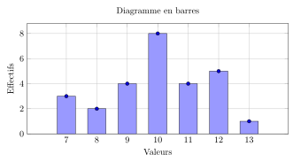
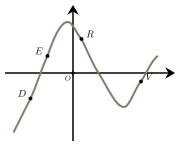
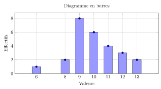
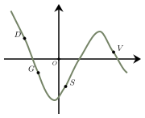


Alice et Louis offrent un voyage d'anniversaire à leur ami Charles. Alice règle les billets de train et Louis règle l'hébergement.

Les billets de train représentent $\dfrac{2}{9}$ de la dépense totale, et l'hébergement représente le reste. Une fois le voyage terminé, ils veulent que chacun ait finalement payé la même somme.

Quelle fraction de la dépense totale Alice doit-elle donner à Louis ?
---CORR---
En notant $D$ la dépense totale, Alice a dépensé $\dfrac{2}{9}D$ et Louis, $\dfrac{7}{9}D$.

Leur participation équilibrée doit être de $\dfrac{1}{2}D$ chacun.

Alice doit donc donner à Louis la somme de $\dfrac{1}{2}D - \dfrac{2}{9}D = \dfrac{5}{18}D$.

La fraction de la dépense totale que Alice doit donner à Louis est donc $\boldsymbol{\dfrac{5}{18}}$.



Soit $x$ un réel.

Démontrer que $-8x^2-16x-6=(-4x-2)(2x+3)$.
---CORR---
On développe le membre de droite :

$\begin{aligned}
\left (-4x-2\right)\left(2x+3\right)&=-8x^2-12x-4x-6\\
&=-8x^2-16x-6\\
\end{aligned}$



Calculer le double du carré de $2$.
---CORR---
Le carré de $2$ est $2^2 = 4$.

Le double de $4$ est $2 \times 4 = 8$.

Le double du carré de $2$ est égal à $\boldsymbol{8}$.



Voici la répartition des notes sur 20 d'une classe de première.

Quel est l'effectif total de cette classe ?
---CORR---
L'effectif total est le nombre de notes représentées dans l'histogramme.

On peut le calculer en additionnant les effectifs de chaque barre.

Les effectifs sont :  
$\bullet$ $3$ pour la note $7$  
$\bullet$ $2$ pour la note $8$ 
$\bullet$ $4$ pour la note $9$ 
$\bullet$ $8$ pour la note $10$ 
$\bullet$ $4$ pour la note $11$ 
$\bullet$ $5$ pour la note $12$ 
$\bullet$ $1$ pour la note $13$. 

Ici, on trouve un effectif total de $\boldsymbol{27}$ élèves.



On lance un dé à $4$ faces. La probabilité d'obtenir chacune des faces est donnée dans le tableau ci-dessous.

<table style="border-collapse: collapse; text-align: center; margin: 1rem auto;">
<thead><tr><th style="border: 1px solid #B85C5C; padding: 8px;">Numéro de la face</th><th style="border: 1px solid #B85C5C; padding: 8px;">1</th><th style="border: 1px solid #B85C5C; padding: 8px;">2</th><th style="border: 1px solid #B85C5C; padding: 8px;">3</th><th style="border: 1px solid #B85C5C; padding: 8px;">4</th></tr></thead>
<tbody><tr><td style="border: 1px solid #B85C5C; padding: 8px;">Probabilité</td><td style="border: 1px solid #B85C5C; padding: 8px;">$\frac{1}{6}$</td><td style="border: 1px solid #B85C5C; padding: 8px;">$0{,}3$</td><td style="border: 1px solid #B85C5C; padding: 8px;">$\frac{1}{5}$</td><td style="border: 1px solid #B85C5C; padding: 8px;">$x$</td></tr></tbody>
</table>

Déterminer $x$.
---CORR---
La somme des probabilités doit être égale à 1.
Comme $0{,}3=\dfrac{3}{10}$, on a :

$\begin{aligned}
x&=1-\left(\dfrac{1}{6}+\dfrac{3}{10}+\dfrac{1}{5}\right)\\
x&=1-\left(\dfrac{5}{30}+\dfrac{9}{30}+\dfrac{6}{30}\right)\\
x&=1-\dfrac{2}{3}\\
x&=\boldsymbol{\dfrac{1}{3}}
\end{aligned}$



On a représenté la courbe $\mathscr{C}$ d'une fonction $f$. Les points $D$, $E$, $R$ et $V$ appartiennent à $\mathscr{C}$ ; leurs abscisses sont notées $x_D$, $x_E$, $x_R$ et $x_V$.

Parmi $x_D$, $x_E$, $x_R$ et $x_V$, lesquelles vérifient l'inéquation $x\times f(x)>0$ ?
---CORR---
L'inéquation est vérifiée lorsque $x$ et $f(x)$ sont de même signe, c'est-à-dire lorsque $x$ et $f(x)$ sont tous les deux positifs ou tous les deux négatifs.

Ici, $x_D$ est négatif et $f(x_D)$ est négatif. Aussi, $x_R$ est positif et $f(x_R)$ est positif.

L'inéquation est donc vérifiée pour $\boldsymbol{x_D \text{ et } x_R}$.



Alice et Louis offrent un voyage d'anniversaire à leur ami Charles. Alice règle les billets de train et Louis règle l'hébergement.

Les billets de train représentent $\dfrac{3}{10}$ de la dépense totale, et l'hébergement représente le reste. Une fois le voyage terminé, ils veulent que chacun ait finalement payé la même somme.

Quelle fraction de la dépense totale Alice doit-elle donner à Louis ?
---CORR---
En notant $D$ la dépense totale, Alice a dépensé $\dfrac{3}{10}D$ et Louis, $\dfrac{7}{10}D$. 
Leur participation équilibrée doit être de $\dfrac{1}{2}D$ chacun. 
Alice doit donc donner à Louis la somme de $\dfrac{1}{2}D - \dfrac{3}{10}D = \dfrac{2}{10}D$. 
La fraction de la dépense totale que Alice doit donner à Louis est donc $\boldsymbol{\dfrac{2}{10}}$.



Soit $x$ un réel.

Démontrer que $-3x^2-9x-6=(-3x-3)(x+2)$.
---CORR---
On développe le membre de droite :  

$$
\begin{aligned}
\left (-3x-3\right)\left(x+2\right)&=-3x^2-6x-3x-6\\
&=-3x^2-9x-6\\
\end{aligned}
$$



Calculer le double de l'inverse de $7$.
---CORR---
L'inverse de $7$ est $\dfrac{1}{7}$.  
Le double  de $\dfrac{1}{7}$ est $\dfrac{2}{7}$. 
Le double de l'inverse  de $7$ est égal à    $\boldsymbol{\dfrac{2}{7}}$.



Voici la répartition des notes sur 20 d'une classe de première.

Quel est l'effectif total de cette classe ?
---CORR---
L'effectif total est le nombre de notes représentées dans l'histogramme. 
On peut le calculer en additionnant les effectifs de chaque barre. 
Les effectifs sont : $1$ pour la note $6$ 
$2$ pour la note $8$ 
$8$ pour la note $9$ 
$6$ pour la note $10$ 
$4$ pour la note $11$ 
$3$ pour la note $12$ 
$2$ pour la note $13$. 
Ici, on trouve un effectif total de $\boldsymbol{26}$ élèves.



On lance un dé à $4$ faces. La probabilité d'obtenir chacune des faces est donnée dans le tableau ci-dessous.

<table style="border-collapse: collapse; text-align: center; margin: 1rem auto;">
<thead><tr><th style="border: 1px solid #B85C5C; padding: 8px;">Numéro de la face</th><th style="border: 1px solid #B85C5C; padding: 8px;">1</th><th style="border: 1px solid #B85C5C; padding: 8px;">2</th><th style="border: 1px solid #B85C5C; padding: 8px;">3</th><th style="border: 1px solid #B85C5C; padding: 8px;">4</th></tr></thead>
<tbody><tr><td style="border: 1px solid #B85C5C; padding: 8px;">Probabilité</td><td style="border: 1px solid #B85C5C; padding: 8px;">$\frac{3}{10}$</td><td style="border: 1px solid #B85C5C; padding: 8px;">$0{,}35$</td><td style="border: 1px solid #B85C5C; padding: 8px;">$0{,}1$</td><td style="border: 1px solid #B85C5C; padding: 8px;">$x$</td></tr></tbody>
</table>

Déterminer $x$.
---CORR---
La somme des probabilités doit être égale à 1.   
Comme $\dfrac{3}{10}=0{,}3$, on a :  

$$
\begin{aligned}
x&=1-\left(0{,}3+0{,}35+0{,}1\right)\\
&=1-0{,}75\\
&=\boldsymbol{0{,}25}
\end{aligned}
$$



---Q---
On a représenté une courbe $\mathscr{C}$ d'une fonction $f$.

Les points $D, G, S \text{ et } V$ appartiennent à $\mathscr{C}$.

Leurs abscisses sont notées respectivement $x_D, x_G, x_S \text{ et } x_V$.

 

L'inéquation $x\times f(x) < 0$ est vérifiée par :

- $x_G \text{ et } x_S$
- $x_G \text{ et } x_V$
- $x_D, x_G \text{ et } x_S$
- $x_D \text{ et } x_S$

---CORR---
L'inéquation est vérifiée lorsque $x$ et $f(x)$ sont de signes opposés, c'est-à-dire lorsque l'un est positif et l'autre négatif. 
Ici, $x_D$ est négatif et $f(x_D)$ est positif. Aussi, $x_S$ est positif et $f(x_S)$ est négatif. 
L'inéquation est donc vérifiée pour $\boldsymbol{x_D \textbf{ et } x_S}$. 
La bonne réponse est la réponse D.


