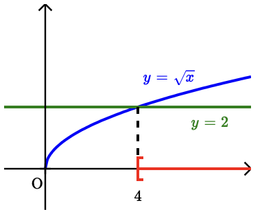
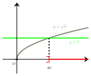


On considère la relation $F=\dfrac{a}{b}+cd$.

Calculer $F$ lorsque $a=2$, $b=\dfrac{1}{7}$, $c=4$ et $d=\dfrac{3}{5}$.
---CORR---
On remplace $a$, $b$, $c$ et $d$ par les valeurs données :

$\begin{aligned}
F &= \dfrac{2}{\dfrac{1}{7}} +4 \times \dfrac{3}{5} \\
&= 14 +\dfrac{12}{5}\\
&= \boldsymbol{\dfrac{82}{5}}
\end{aligned}$



On considère les trois fonctions définies par :

$$f_1\ :\ x \longmapsto x^2-(x+3)(x-5)\qquad f_2\ :\ x \longmapsto 5\sqrt{x}+3\qquad f_3\ :\ x \longmapsto\dfrac{3}{x}-6$$

Lesquelles de ces fonctions sont affines ?
---CORR---
On cherche si les fonctions $f$ peuvent s'écrire sous la forme $f(x)=mx+p$.
$\bullet$ En développant, on obtient :

$\begin{aligned}
f_1(x)&=x^2-(x+3)(x-5)\\
&=x^2-(x^2-5x+3x-15)\\
&=x^2-x^2+5x-3x+15\\
&=2x+15
\end{aligned}$

On retrouve une forme $mx+p$, donc $f_1$ est une fonction affine.

$\bullet$ $f_2(x)=5\sqrt{x}+3$

Cette fonction contient un terme en $\sqrt{x}$, elle n'est donc pas affine.
$\bullet$ $f_3(x)=\dfrac{3}{x}-6$

Cette fonction contient un terme en $\dfrac{1}{x}$, elle n'est donc pas affine.

**Uniquement la fonction $f_1$ est affine.**



Soit $n$ un entier non nul.

Simplifier $\left(-1\right)^{n+4}$.
---CORR---
$\begin{aligned} \left(-1\right)^{n+4}&=\left(-1\right)^{4} \times \left(-1\right)^{n} \\
&=1\times \left(-1\right)^{n} \\
&=\boldsymbol{\left(-1\right)^{n}}
\end{aligned}$



On a représenté la courbe d'équation $y=\sqrt{x}$.

Résoudre sur $[0\ ;\ +\infty[$ l'inéquation $\sqrt{x}\geqslant 2$.
---CORR---
Pour résoudre graphiquement cette inéquation :

$\bullet$ On trace la courbe d'équation $y=\sqrt{x}$.

$\bullet$ On trace la droite horizontale d'équation $y=2$. Cette droite coupe la courbe en $2^2=4$.

$\bullet$ Les solutions de l'inéquation sont les abscisses des points de la courbe qui se situent sur ou au dessus de la droite.

Comme la fonction racine carrée est définie sur $[0\ ;\ +\infty[$, l'ensemble des solutions de l'inéquation est : **$S = [4\ ;\ +\infty[$**.



On donne la série statistique suivante : $7$ ; $11$ ; $15$ ; $7$ ; $5$.

Quelle valeur faut-il ajouter à la série pour que sa moyenne soit égale à $10$ ?
---CORR---
Appelons $x$ la valeur cherchée.

On commence par calculer la somme des valeurs de la série de l'énoncé :

$7 + 11 + 15 + 7 + 5 = 45$.

Comme la série de l'énoncé contient $5$ valeurs, la nouvelle série avec $x$ en contient $6$.

On peut calculer sa moyenne avec l'expression : $\dfrac{45 + x}{6}$

Comme cette moyenne vaut $10$ d'après l'énoncé, il faut alors résoudre l'équation :

$\dfrac{45 + x}{6} = 10$

$45 + x = 10 \times 6$

$x = 10 \times 6 - 45$

$x = \boldsymbol{15}$



Dans un lycée, $160$ élèves étudient l'espagnol, ce qui représente $25\ $% des élèves inscrits.

Combien d'élèves sont inscrits dans ce lycée ?
---CORR---
En notant $N$ le nombre total d'élèves,
$25\ $% de $N$ est égal à $160$ élèves.

Puisque $25\ $%$ =\dfrac{25}{100}=\dfrac{1}{4}$, alors $N$ est $4$ fois plus grand que $160$.

Ainsi, $N=4\times 160$ élèves soit
$\boldsymbol{640}$ élèves au total.



On considère la relation $F=a+\dfrac{b}{cd}$.

Calculer $F$ lorsque $a=\dfrac{1}{7}$, $b=1$, $c=8$ et $d=-\dfrac{1}{8}$.
---CORR---
On remplace $a$, $b$, $c$ et $d$ par les valeurs données :  

$$
\begin{aligned}
F&=\dfrac{1}{7}+\dfrac{1}{8\times \left(-\dfrac{1}{8}\right)}\\
&=\dfrac{1}{7}+\dfrac{1}{-1}\\
&=\dfrac{1}{7}-1\\
&=\boldsymbol{-\dfrac{6}{7}}
\end{aligned}
$$



On considère les trois fonctions définies par :

$$f_1\ :\ x \longmapsto x^2-(x+2)(x-4)\qquad f_2\ :\ x \longmapsto 2\sqrt{x}+4\qquad f_3\ :\ x \longmapsto\dfrac{2}{x}-7$$

Lesquelles de ces fonctions sont affines ?
---CORR---
On cherche si les fonctions $f$ peuvent s'écrire sous la forme $f(x)=mx+p$. 
$\bullet$ En développant, on obtient : 

$$
\begin{aligned}
f_1(x)&=x^2-(x+2)(x-4)\\
&=x^2-(x^2-4x+2x-8)\\
&=x^2-x^2+4x-2x+8\\
&=2x+8
\end{aligned}
$$

On retrouve une forme $mx+p$, donc $f_1$ est une fonction affine. 
$\bullet$ $f_2(x)=2\sqrt{x}+4$ 
Cette fonction contient un terme en $\sqrt{x}$, elle n'est donc pas affine. 
$\bullet$ $f_3(x)=\dfrac{2}{x}-7$ 
Cette fonction contient un terme en $\dfrac{1}{x}$, elle n'est donc pas affine. 
Uniquement la fonction $f_1$ est affine.



Soit $n$ un entier non nul.

Simplifier $\left(-1\right)^{n+6}$.
---CORR---
$$
\begin{aligned} \left(-1\right)^{n+6}&=\left(-1\right)^{6} \times \left(-1\right)^{n} \\
&=1\times \left(-1\right)^{n} \\
&=\boldsymbol{\left(-1\right)^{n}}
\end{aligned}
$$



On a représenté la courbe d'équation $y=\sqrt{x}$.

Résoudre sur $[0\ ;\ +\infty[$ l'inéquation $\sqrt{x}>7$.
---CORR---
Pour résoudre graphiquement cette inéquation :  
$\bullet$ On trace la courbe d'équation $y=\sqrt{x}$.  
$\bullet$ On trace la droite horizontale d'équation $y=7$. Cette droite coupe la courbe en $7^2=49$.  
$\bullet$ Les solutions de l'inéquation sont les abscisses des points de la courbe qui se situent strictement au dessus de la droite. 

Comme la fonction racine carrée est définie sur $[0\,;\,+\infty[$, l'ensemble des solutions de l'inéquation est : $S = ]49\,;\,+\infty[$.



On donne la série statistique suivante : $11$ ; $15$ ; $5$ ; $14$.

Quelle valeur faut-il ajouter à la série pour que sa moyenne soit égale à $10$ ?
---CORR---
Appelons $x$ la valeur cherchée. 
On commence par calculer la somme des valeurs de la série de l'énoncé : 
$11 + 15 + 5 + 14 = 45$. 
Comme la série de l'énoncé contient $4$ valeurs, la nouvelle série avec $x$ en contient $5$.

On peut calculer sa moyenne avec l'expression : $\dfrac{45 + x}{5}$ 
Comme cette moyenne vaut $10$ d'après l'énoncé, il faut alors résoudre l'équation :  
$\dfrac{45 + x}{5} = 10$

$45 + x = 10 \times 5$

$x = 10 \times 5 - 45$

$x = \boldsymbol{5}$



Dans un lycée, $40$ élèves étudient le grec, ce qui représente $4\ $% des élèves inscrits.

Combien d'élèves sont inscrits dans ce lycée ?
---CORR---
En notant $N$ le nombre total d'élèves,
$4\,\%$ de $N$ est égal à $40$ élèves. 
Puisque $4\,\% =\dfrac{4}{100}=\dfrac{1}{25}$, alors $N$ est $25$ fois plus grand que $40$. 
Ainsi,  $N=25\times 40$ élèves soit
$\boldsymbol{1\,000}$ élèves au total.


