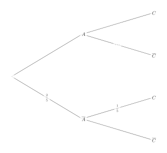
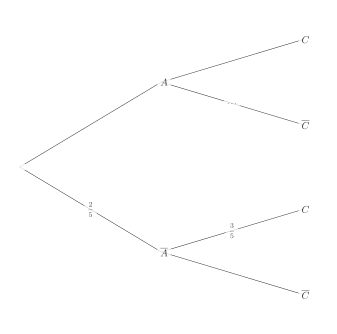


On considère deux réels $a$ et $b$ strictement positifs tels que $a>b$.

Donner le signe de $a-b$.
---CORR---
Comme $a > b$, on a $a - b > 0$.



La probabilité d'un événement $A$ est $\dfrac{5}{8}$.

Quelle est la probabilité de son événement contraire ?
---CORR---
La relation entre la probabilité d'un événement $A$ et celle de son contraire $\overline{A}$ est : $P(\overline{A})=1-P(A)$.

Ainsi : $P(\overline{A})=1-\dfrac{5}{8}=\dfrac{3}{8}$.



Sur $60$ arbres dans un parc, on distingue trois groupes : chênes ($20$ arbres), érables ($20$ arbres) et autres essences (le reste).

On veut représenter cette situation par un diagramme circulaire. Quelle est la mesure de l'angle de chaque secteur ?
---CORR---
Les effectifs des $3$ groupes sont respectivement $20$, $20$ et $60-20-20=20$.

$$\begin{array}{|c|c|c|c|}
\hline
\text{Groupe} & \text{chênes} & \text{érables} & \text{autres}\\
\hline
\text{Effectif} & 20 & 20 & 20\\
\hline
\text{Part} & \dfrac{1}{3} & \dfrac{1}{3} & \dfrac{1}{3}\\
\hline
\text{Angle} & 120^{\circ} & 120^{\circ} & 120^{\circ}\\
\hline
\end{array}$$

Chacun des trois secteurs mesure $\boldsymbol{120^{\circ}}$.



Donner les coordonnées du point d'intersection de la droite d'équation $y=\dfrac{x}{9}-5$ avec l'axe des abscisses.
---CORR---
L'ordonnée de ce point est $0$ puisqu'il se situe sur l'axe des abscisses. Son abscisse est donc donnée par la solution de $\dfrac{x}{9}-5=0$, c'est-à-dire $x=45$.

Les coordonnées de ce point sont donc $(45\,;\,0)$.



Dans une région de France, le tarif de l'eau est le suivant : un abonnement annuel de $50{,}80$ € et $3{,}84$ € par mètre cube consommé. Une famille a payé une facture de $373{,}36$ € pour sa consommation annuelle.

Écrire un calcul qui donne le nombre de mètres cubes consommés.
---CORR---
En notant $a$ le nombre de mètres cubes consommés, la facture s'écrit :

$$\begin{aligned}
50{,}80+3{,}84\times a &= 373{,}36\\
a &= \dfrac{373{,}36-50{,}80}{3{,}84}
\end{aligned}$$



On donne l'arbre de probabilités ci-dessous.

On sait que $P(A\cap C)=\dfrac{6}{25}$. Calculer $P_A(\overline{C})$.
---CORR---
On déduit de l'arbre : $P(A)=1-P(\overline{A})=1-\dfrac{2}{5}=\dfrac{3}{5}$.

Avec $P(A \cap C)=\dfrac{6}{25}$, on calcule :

$$P_A(C)=\dfrac{P(A \cap C)}{P(A)}=\dfrac{\dfrac{6}{25}}{\dfrac{3}{5}}=\dfrac{6}{25}\times\dfrac{5}{3}=\dfrac{2}{5}$$

On obtient alors :

$$P_A(\overline{C})=1-P_A(C)=1-\dfrac{2}{5}=\dfrac{3}{5}$$



On considère un réel $a$ tel que $a>1$.

Comparer $\sqrt{a}$ et $1$.
---CORR---
La fonction racine carrée est strictement croissante sur $[0\,;\,+\infty[$. 
Comme $a>1$, on a $\sqrt{a}>\sqrt{1}$, c'est-à-dire $\boldsymbol{\sqrt{a}>1}$.



La probabilité d'un événement $A$ est $\dfrac{8}{9}$.

Quelle est la probabilité de son événement contraire ?
---CORR---
La relation entre la probabilité d'un événement $A$ et celle de son contraire $\overline{A}$ est :  $P(\overline{A})=1-P(A)$. 
Ainsi : $P(\overline{A})=1-\dfrac{8}{9}=\dfrac{1}{9}$.



Sur $160$ logements d'un quartier, on distingue trois groupes : appartements ($80$ logements), maisons individuelles ($40$ logements) et autres types (le reste).

On veut représenter cette situation par un diagramme circulaire. Quelle est la mesure de l'angle de chaque secteur ?
---CORR---
Les effectifs des 3 groupes sont respectivement $80$, $40$ et $160-80-40=40$.

$$
\begin{array}{|c|c|c|c|}
\hline
\text{Groupe} & \text{appartements} & \text{maisons} & \text{autres}\\
\hline
\text{Effectif} & 80 & 40 & 40\\
\hline
\text{Part} & \dfrac{1}{2} & \dfrac{1}{4} & \dfrac{1}{4}\\
\hline
\text{Angle} & 180° & 90° & 90°\\
\hline
\end{array}
$$

Le diagramme a un secteur de $\boldsymbol{180°}$ (appartements) et deux secteurs de $\boldsymbol{90°}$ (maisons et autres).



Donner les coordonnées du point d'intersection de la droite d'équation $y=\dfrac{x}{3}+5$ avec l'axe des abscisses.
---CORR---
L'ordonnée de ce point est $0$ puisque le point d'intersection se situe sur l'axe des abscisses. 
Son abscisse est donc donnée par la solution de l'équation  $\dfrac{x}{3}+5=0$, c'est-à-dire $x=-15$.

Les coordonnées de ce   point sont donc : $(\boldsymbol{-15\,;\,0})$.



Dans une région de France, le tarif de l'eau est le suivant : un abonnement annuel de $49{,}30$ € et $3{,}57$ € par mètre cube consommé. Une famille a payé une facture de $313{,}48$ € pour sa consommation annuelle.

Écrire un calcul qui donne le nombre de mètres cubes consommés.
---CORR---
La facture s'élève à $313{,}48$\,€~pour la consommation annuelle. 
En notant $a$ le nombre de  mètres cubes consommés, on obtient :  

$$
\begin{aligned}
49{,}3+3{,}57\times a &=313{,}48\\
a&=\boldsymbol{\dfrac{313{,}48-49{,}30}{3{,}57}}
\end{aligned}
$$



On donne l'arbre de probabilités ci-dessous.

On sait que $P(A\cap C)=\dfrac{21}{50}$. Calculer $P_A(\overline{C})$.
---CORR---
On déduit de l'énoncé 

$$
\begin{aligned}
P(A)&=1-P(\overline{A})\\
&=1-\dfrac{2}{5}\\
&=\dfrac{3}{5}.\end{aligned}
$$

Avec la donnée de $P(A \cap C)=\dfrac{21}{50}$ dans l'énoncé, on peut alors calculer :  

$$
\begin{aligned}
P_A(C)&=\dfrac{P(A \cap C)}{P(A)}\\
&=\dfrac{ \dfrac{21}{50}}{ \dfrac{3}{5}} \\
&=\dfrac{21}{50} \times \dfrac{5}{3} \\
&= \dfrac{7}{10}.
\end{aligned}
$$

On sait alors que  

$$
\begin{aligned}
P_A(\overline{C})&=1-P_A(C)\\
&=1-\dfrac{7}{10}\\
&=\dfrac{3}{10} .\end{aligned}
$$


