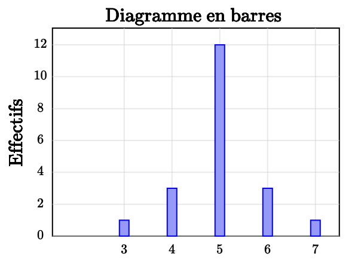
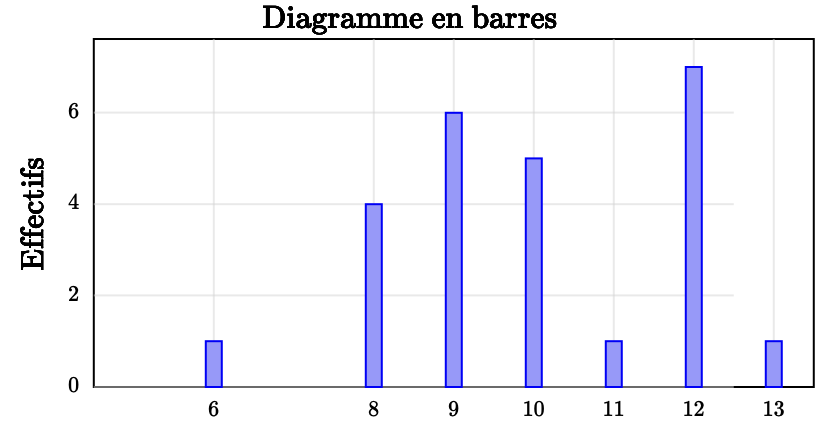


On dispose d'une urne A contenant $4$ boules numérotées $2$ ; $13$ ; $26$ ; $30$ et d'une urne B contenant $6$ boules numérotées $6$ ; $15$ ; $17$ ; $19$ ; $20$ ; $27$. Les boules sont indiscernables au toucher.

Dans quelle urne la probabilité d'obtenir une boule portant un nombre premier est-elle la plus grande ?
---CORR---
Dans l'urne A, les nombres premiers sont $2$ et $13$ : la probabilité est $\dfrac{2}{4}=\dfrac{1}{2}$.

Dans l'urne B, les nombres premiers sont $17$ et $19$ : la probabilité est $\dfrac{2}{6}=\dfrac{1}{3}$.

Comme $\dfrac{1}{2}>\dfrac{1}{3}$, la probabilité d'obtenir un nombre premier est plus grande avec l'**urne A**.



On lance un dé cubique truqué quatre fois de suite. La probabilité d'obtenir au moins une fois $6$ lors des quatre lancers est égale à $0{,}518$.

Quelle est la probabilité de n'obtenir aucun $6$ lors des quatre lancers ?
---CORR---
On note $A$ l'événement "obtenir au moins un 6" et $B$ l'événement "n'obtenir aucun 6". 
Les événements $A$ et $B$ sont contraires. 
Donc : $P(B) = 1 - P(A)$. 
$P(B) = 1 - 0,518 = 0,482$



Soit $n$ un entier non nul.

Simplifier $4^n+4^n$.
---CORR---
$4^n+4^n=2\times 4^n$



Combien de solutions réelles l'équation $4=-x^2+15$ possède-t-elle ?
---CORR---
L'équation est équivalente à $-x^2=4-15$, soit $x^2=11$. 
$11$ étant strictement positif, cette équation a $2$ solutions : $\sqrt11$ et  $-\sqrt11$.



Calculer, en $\text{hm}^2$, l'aire d'un carré de côté $300\ \text{m}$.
---CORR---
$300$ $\text {m}$ $= 3$ $\text{hm}$ 
L'aire du carré est : $3 \text { hm}\times 3 \text { hm} = 9 \text{ hm}^2$ .



Voici la répartition des notes sur 10 d'une classe de première.

Quel pourcentage des élèves a obtenu la note $5$ ?
---CORR---
Le pourcentage d'élèves ayant obtenu la note 5 est calculé en divisant l'effectif de cette note par l'effectif total, puis en multipliant par 100. 
L'effectif total est le nombre de notes représentées dans l'histogramme. 
Ici, on trouve un effectif total de $20$ élèves. 
L'effectif des élèves ayant obtenu la note 5 est de $12$. 
$\dfrac1220 \times 100 = 60$ 
Donc le pourcentage est de $60$ %.



On dispose d'une urne A contenant $6$ boules numérotées $6$ ; $7$ ; $9$ ; $10$ ; $15$ ; $16$ et d'une urne B contenant $5$ boules numérotées $5$ ; $12$ ; $23$ ; $25$ ; $29$. Les boules sont indiscernables au toucher.

Dans quelle urne la probabilité d'obtenir une boule portant un multiple de $3$ est-elle la plus grande ?
---CORR---
Dans l'urne A, les issues favorables sont : $6, 9, 15$. 
$P_A = \dfrac{3}{6} = \dfrac{1}{2}$ 
Dans l'urne B, il n'y a qu'une seule issue favorable : $12$. 
$P_B = \dfrac{1}{5}$ 
On a $\dfrac{1}{2} = \dfrac{5}{10}$ et $\dfrac{1}{5} = \dfrac{2}{10}$ et comme $\dfrac{1}{2} > \dfrac{1}{5}$, donc : 
La probabilité d'obtenir une boule portant un multiple de 3 est plus grande en choisissant l'urne A.



Dans une production, $10\ $% des pièces sont défectueuses. On prélève quatre pièces au hasard. La probabilité qu'aucune pièce ne soit défectueuse est environ $0{,}656$.

Quelle est la probabilité qu'au moins une pièce soit défectueuse ?
---CORR---
On note $A$ l'événement «  au moins une pièce est défectueuse  » et $B$ l'événement «  aucune pièce n'est défectueuse  ». 
Les événements $A$ et $B$ sont contraires. 
Donc : $P(A) = 1 - P(B)$. 
$P(A) = 1 - 0{,}656 = 0{,}344$



Soit $n$ un entier non nul.

Simplifier $3^n+3^n$.
---CORR---
$$
\begin{aligned} 3^{n}+3^n&=2\times 3^{n}\end{aligned}
$$



Combien de solutions réelles l'équation $19=-x^2+9$ possède-t-elle ?
---CORR---
L'équation est équivalente à $-x^2=19-9$, soit $x^2=-10$. 
Cette équation a $\boldsymbol{0}$ solution réelle car $-10<0$.



Calculer, en $\text{dam}^2$, l'aire d'un carré de côté $80\ \text{m}$.
---CORR---
$80$ $\text{ m}$ $= 8$ $\text{dam}$ 
L'aire du carré est : $8 \text{ dam}\times 8 \text{ dam} = \boldsymbol{64\textbf{ dam}^2}$ .



Voici la répartition des notes sur 20 d'une classe de première.

Quel pourcentage des élèves a obtenu la note $9$ ?
---CORR---
Le pourcentage d'élèves ayant obtenu la note 9 est calculé en divisant l'effectif de cette note par l'effectif total, puis en multipliant par 100. 
L'effectif total est le nombre de notes représentées dans l'histogramme. 
Ici, on trouve un effectif total de $25$ élèves. 
L'effectif des élèves ayant obtenu la note 9 est de $6$. 
$\dfrac{6}{25} \times 100 = 24$ 
Donc le pourcentage est de $24~\%$.


