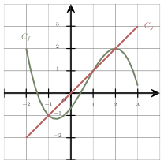
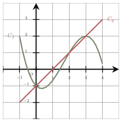


Donner, en mL, un ordre de grandeur de la contenance d'une baignoire.
---CORR---
Une baignoire contient environ $200$ $\text{L}$, soit $200\,000\textbf{ mL}$.



Soit $g$ la fonction affine définie sur $\mathbb{R}$ par $g(x)=-3x+b$, de courbe représentative $\mathscr{D}$. Le point $A(2\ ;\ -13)$ appartient à $\mathscr{D}$.

Donner l'ordonnée du point de $\mathscr{D}$ d'abscisse $1$.
---CORR---
On cherche d'abord la valeur de $b$ en utilisant la condition donnée dans l'énoncé. 
$A(2~;~-13)$ appartient à $\mathscr{D}$ signifie que $g(2)=-13$.
$$\begin{aligned}
g(2)&=-13\\
-3\times 2+b&=-13\\
-6+b&=-13\\
b&=-13+6\\
b&=-7
\end{aligned}$$
On a donc $g(x)=-3x-7$.
L'image de $1$ par cette fonction correspond à l'ordonnée du point de $\mathscr{D}$ dont l'abscisse est $1$ :
$$\begin{aligned}
g(1)&=-3\times 1-7\\
&=-3-7\\
&=-10
\end{aligned}$$



Sur la figure ci-dessous, $C_f$ et $C_g$ représentent les fonctions $f$ et $g$ définies sur $[-2\,;\,3]$.

Résoudre graphiquement l'inéquation $f(x)<g(x)$.
---CORR---
Les solutions de l'inéquation sont les abscisses des points de $C_f$ qui se situent en dessous de $C_g$, soit $]-1\,;\,1[\cup ]2\,;\,3]$.



Simplifier $0{,}63a-2a$.
---CORR---
À l'aide d'une factorisation, on obtient :
$$\begin{aligned}
0{,}63a-2a  &=(0{,}63-2)a\\
&=-1{,}37a
\end{aligned}$$



Résoudre l'équation $7(6x-6)=-3x-9$.
---CORR---
On développe, puis on isole l'inconnue dans le membre de gauche :
$$\begin{aligned}
7(6x-6)&=-3x-9\\
42x-42&=-3x-9\\
42x-42+3x&=-3x-9+3x\\
45x-42&=-9\\
45x-42+42&=-9+42\\
45x&=33\\
x&=\dfrac{33}{45}
\\x&=\dfrac{11}{15}\end{aligned}$$

La solution est $\dfrac{11}{15}$.



Voici les $4$ notes sur vingt obtenues par un élève en mathématiques :

$$\begin{array}{|c|c|c|c|c|}
\hline
\text{Devoir} & 1 & 2 & 3 & 4\\
\hline
\text{Note} & 10 & 13 & 14 & x\\
\hline
\text{Coefficient} & 1 & 1 & 1 & 2\\
\hline
\end{array}$$

Que doit valoir $x$ pour que la moyenne de l'élève soit égale à $15$ ?
---CORR---
Pour déterminer la moyenne de l'élève, on calcule : 
• La somme des produits de chaque note par son coefficient : 

$10 \times 1 + 13 \times 1 + 14 \times 1 + x \times 2 = 37 + 2x$. 
• La somme des coefficients : $1 + 1 + 1 + 2= 5$. 

Remarque : On fera bien attention à ne pas utiliser la ligne des numéros de devoirs du tableau, donnée qui n'intervient pas dans le calcul de la moyenne. 

La moyenne est donc égale à $\dfrac{37 + 2x}{5}$.  
Comme elle doit être égale à $15$, on doit résoudre l'équation suivante :

$$\begin{aligned}
\dfrac{37 + 2x}{5} &= 15\\
37 + 2x &= 15 \times 5\\
37 + 2x&= 75\\
2x &= 75 - 37\\
2x &= 38\\
x &= \dfrac{38}{2}\\
x&= 19.
\end{aligned}$$



Donner, en mètres, un ordre de grandeur de la longueur d'un stylo.
---CORR---
Un stylo mesure environ $15$ $\text{cm}$, soit $\boldsymbol{0{,}15\textbf{ m}}$.



Soit $g$ la fonction affine définie sur $\mathbb{R}$ par $g(x)=3x+b$, de courbe représentative $\mathscr{D}$. Le point $A(3\ ;\ 6)$ appartient à $\mathscr{D}$.

Donner l'ordonnée du point de $\mathscr{D}$ d'abscisse $4$.
---CORR---
On cherche d'abord la valeur de $b$ en utilisant la condition donnée dans l'énoncé. 
$A(3~;~6)$ appartient à $\mathcal{D}$ signifie que $g(3)=6$. 

$$
\begin{aligned}
g(3)&=6\\
3\times 3+b&=6\\
9+b&=6\\
b&=6-9\\
b&=-3
\end{aligned}
$$

On a donc $g(x)=3x-3$. 
L'image de $4$ par cette fonction correspond à  l'ordonnée du point de  $\mathcal{D}$ dont l'abscisse est $4$ : 

$$
\begin{aligned}
g(4)&=3\times 4-3\\
&=12-3\\
&=\boldsymbol{9}
\end{aligned}
$$



Sur la figure ci-dessous, $C_f$ et $C_g$ représentent les fonctions $f$ et $g$ définies sur $[-1\,;\,4]$.

Résoudre graphiquement l'inéquation $f(x)\leqslant g(x)$.
---CORR---
Les solutions de l'inéquation sont les abscisses des points de $C_f$ qui se situent en dessous ou sur $C_g$, soit $\boldsymbol{[0\,;\,2]\cup [3\,;\,4]}$.



Simplifier $0{,}4a-a$.
---CORR---
À l'aide d'une factorisation, on obtient : 

$$
\begin{aligned}
0{,}4a-a&=0{,}4a-1a\\
&=(0{,}4-1)a\\
&=\boldsymbol{-0{,}6a}
\end{aligned}
$$



Résoudre l'équation $4-(x+5)=3x+8$.
---CORR---
On développe, puis on isole l'inconnue dans le membre de gauche : 

$$
\begin{aligned}
4-(x+5)&=3x+8\\
4-1x-5&=3x+8\\
-x-1&=3x+8\\
-x-1\boldsymbol{-3x}&=3x+8\boldsymbol{-3x}\\
-4x-1&=8\\
-4x-1\boldsymbol{+1}&=8\boldsymbol{+1}\\
-4x&=9\\
x&=\dfrac{9}{-4}\\
x&=-\dfrac{9}{4}
\end{aligned}
$$

La solution est $\boldsymbol{-\dfrac{9}{4}}$.



Voici les $4$ notes sur vingt obtenues par un élève en mathématiques :

$$\begin{array}{|c|c|c|c|c|}
\hline
\text{Devoir} & 1 & 2 & 3 & 4\\
\hline
\text{Note} & 14 & 11 & 15 & x\\
\hline
\text{Coefficient} & 1 & 1 & 1 & 2\\
\hline
\end{array}$$

Que doit valoir $x$ pour que la moyenne de l'élève soit égale à $16$ ?
---CORR---
Pour déterminer la moyenne de l'élève, on calcule : 
$\bullet$ La somme des produits de chaque note par son coefficient :

$14 \times 1 + 11 \times 1 + 15 \times 1 + x \times 2 = 40 + 2x$. 
$\bullet$ La somme des coefficients : $1 + 1 + 1 + 2= 5$.

Remarque : On fera bien attention à ne pas utiliser la ligne des numéros de devoirs du tableau, donnée qui n'intervient pas dans le calcul de la moyenne.

La moyenne est donc égale à $\dfrac{40 + 2x}{5}$.  
Comme elle doit être égale à $16$, on doit résoudre l'équation suivante :

$$
\begin{aligned}
\dfrac{40 + 2x}{5} &= 16\\
40 + 2x &= 16 \times 5\\
40 + 2x&= 80\\
2x &= 80 - 40\\
2x &= 40\\
x &= \dfrac{40}{2}\\
x&= \boldsymbol{20}.
\end{aligned}
$$


