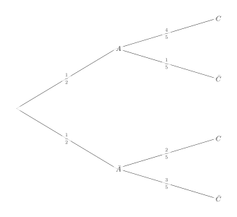
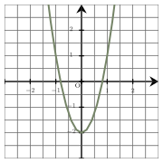
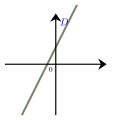
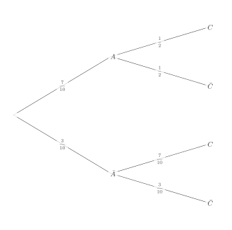
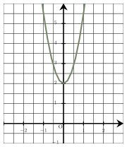
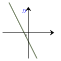


On donne l'arbre de probabilités ci-dessous.

Calculer $P_C(A)$.
---CORR---
On sait que $ P_C(A)=\dfrac{P(A \cap C)}{P(C)}$

D'après la formule des probabilités totales :

$$\begin{aligned}
P(C)&=p(A\cap C)+p(\bar A \cap C)\\
&=P(A)\times P_A(C)+P(\bar A)\times P_{\bar A}(C)\\
&=\dfrac{1}{2}\times \dfrac{4}{5}+\dfrac{1}{2}\times \dfrac{2}{5}\\
&=\dfrac{2}{5}+\dfrac{1}{5}\\
&=\dfrac{3}{5}
\end{aligned}$$

Et donc :
$$\begin{aligned}
P_C(A)&=\dfrac{P(A \cap C)}{P(C)}\\
&=\dfrac{P(A)\times P_A(C)}{P(C)}\\
&=\dfrac{\dfrac{2}{5}}{\dfrac{3}{5}}\\
&=\dfrac{2}{3}
\end{aligned}$$



Une augmentation de $10\ $% du prix d'un article entraîne une hausse de $24$ €.

Quel était le prix de cet article avant l'augmentation ?
---CORR---
$10\,$ % du prix représente $24$ €, donc $100$ % du prix représente $10$ fois plus que $24$ € (car $10\times 10=100$).

Le prix de l'article était donc : $10\times24=240$ €.



Voici la représentation graphique d'une fonction $f$ définie sur $\mathbb{R}$ par $f(x)=ax^2+b$.

Déterminer $a$ et $b$.
---CORR---
La valeur de $b$ est donnée par l'image de $0$ par $f$ (ordonnée du point d'intersection entre la courbe et l'axe des ordonnées).

Ainsi, $b=-2$.

La valeur de $a$ s'obtient (par exemple) grâce à l'image de $1$ par la fonction $f$.

On lit $f(1)=1$.

D'où, $a\times 1^2-2=1$, soit $a=3$.

Ainsi, $f(x)=3x^2-2$.



Soit $x$ un réel.

Développer et réduire $-4(x+4)^2+2$.
---CORR---
On développe l'expression de l'énoncé.

$$\begin{aligned}
-4(x+4)^2+2&=-4\left(x^2 +8x+16\right)+2\\
&=-4x^2 -32x-64 +2\\
&=-4x^2 -32x-62\\
\end{aligned}$$



On a représenté ci-dessous une droite $D$ d'équation $y=mx+p$.

Donner le signe de $m$ et le signe de $p$.
---CORR---
On observe sur le graphique que le coefficient directeur est positif ($D$ représente une fonction affine croissante) et que l'ordonnée à l'origine est strictement positive ($D$ coupe l'axe des ordonnées au-dessus de l'origine).



Donner l'écriture décimale du nombre $2{,}14\times 10^{-3}$.
---CORR---
Multiplier par  $10^{-3}$ revient à multiplier par $0{,}001$,  donc l'écriture décimale de $2{,}14\times 10^{-3}$ est : $0{,}002\,14$.



On donne l'arbre de probabilités ci-dessous.

Calculer $P_C(A)$.
---CORR---
On sait que $ P_C(A)=\dfrac{P(A \cap C)}{P(C)}$ 
D'après la formule des probabilités totales : 

$$
\begin{aligned}P(C)&=p(A\cap C)+p(\bar A \cap C)\\
&=P(A)\times P_A(C)+P(\bar A)\times P_{\bar A}(C)\\
&=\dfrac{7}{10}\times \dfrac{1}{2}+\dfrac{3}{10}\times \dfrac{7}{10}\\
&=\dfrac{7}{20}+\dfrac{21}{100}\\
&=\dfrac{14}{25}\\
\end{aligned}
$$

$$
\begin{aligned}
P_C(A)&=\dfrac{P(A \cap C)}{P(C)}\\
&=\dfrac{P(A)\times P_A(C)}{P(C)}\\
&=\dfrac{\dfrac{7}{20}}{\dfrac{14}{25}}\\
&=\dfrac{5}{8}\\
\end{aligned}
$$



Parmi les $2\,000$ logements d'une ville, $10\ $% sont des maisons et $80\ $% de celles-ci sont des T2.

Combien y a-t-il de maisons de type T2 dans cette ville ?
---CORR---
Les maisons  représentent $10\%$   des logements. 
Il y en a donc : $0{,}1\times 2\,000=200$. 
Dans cette ville, il y a  $200$ maisons. 
Parmi ces maisons, il y a $80\,\%$  de T2. 
$80\,\%$  de $200=0{,}8\times 200=160$. 
Il y a donc $\boldsymbol{160}$ maisons de type T2 dans cette ville.

Mentalement :  
Prendre $10\,\%$  d'une quantité revient à la diviser par $10$.  
Pour calculer $20\,\%$, $30\,\, \%$, $40\,\%$, .... d'une quantité, on
commence par calculer  $10\,\%$  de cette quantité en la divisant par $10$, puis on multiplie
par $2$ ce résultat si on veut en calculer $20\, \%$, par $3$ si on veut en calculer $30\,\%$, ....



Voici la représentation graphique d'une fonction $f$ définie sur $\mathbb{R}$ par $f(x)=ax^2+b$.

Déterminer $a$ et $b$.
---CORR---
La valeur de $b$ est donnée par l'image de $0$ par $f$ (ordonnée du point d'intersection entre la courbe et l'axe des ordonnées). 
Ainsi, $b=\boldsymbol{2}$. 
La valeur de $a$ s'obtient (par exemple) grâce à l'image de $1$ par la fonction $f$. 
On lit $f(1)=5{,}5$. D'où, $a\times 1^2+2=5{,}5$, soit $a=\boldsymbol{3{,}5}$. 
Ainsi, $f(x)=3{,}5x^2+2$.



Soit $x$ un réel.

Développer et réduire $-4(x+2)^2-1$.
---CORR---
On développe l'expression de l'énoncé.  

$$
\begin{aligned}
-4(x+2)^2-1&=-4\left(x^2 +4x+4\right)-1\\
&=-4x^2 -16x-16 -1\\
&=\boldsymbol{-4x^2 -16x-17}\\
\end{aligned}
$$



On a représenté ci-dessous une droite $D$ d'équation $y=mx+p$.

Donner le signe de $m$ et le signe de $p$.
---CORR---
On observe sur le graphique que le coefficient directeur est négatif ($D$ représente une fonction affine décroissante) et que l'ordonnée à l'origine est strictement négative ($D$ coupe l'axe des ordonnées en dessous de l'origine).



Donner l'écriture décimale du nombre $9{,}41\times 10^{-4}$.
---CORR---
Multiplier par  $10^{-4}$ revient à multiplier par $0{,}000\,1$,  donc l'écriture décimale de $9{,}41\times 10^{-4}$ est : $\boldsymbol{0{,}000\,941}$.


