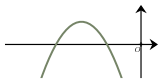


Résoudre l'équation $\dfrac{x}{9}=0$.
---CORR---
On multiplie par $9$ chacun des deux membres de l'équation pour obtenir $x=0$. 
C'est bien $0\div 9$ qui est égal à $0$. 
Ainsi, la solution de l'équation est **0**.



Dans une salle de sport, on paie chaque mois un abonnement, puis un tarif fixe pour chaque séance. Un client a payé $21$ euros pour $2$ séances un mois, et $33$ euros pour $4$ séances le mois suivant.

Quel est le montant de l'abonnement mensuel ?
---CORR---
On note $a$ le montant de l'abonnement mensuel et $p$ le prix d'une séance. 

D'après le premier ticket : $a + 2p = 21$. 

D'après le second ticket : $a + 4p = 33$. 

En faisant la différence entre ces deux montants, on obtient :
$4p - 2p = 12$ soit $2p=12$.  

Donc le montant pour $1$ séance est : $p = 6$ €. 

On peut alors calculer le montant de l'abonnement mensuel :
$a = 21 - 2 \times 6 = 21 - 12 = 9$ €. 

Le montant de l'abonnement mensuel est donc de **9 €**.



On considère $A=100+0{,}1+\dfrac{1}{1\,000}$.

Écrire $A$ sous la forme d'une fraction de dénominateur $1\,000$.
---CORR---
On a :
$$\begin{aligned}
A &= 100 + 0{,}1 + \dfrac{1}{1\,000}\\
&= \dfrac{100\,000}{1\,000} + \dfrac{100}{1\,000} + \dfrac{1}{1\,000}\\
&= \dfrac{100\,101}{1\,000}
\end{aligned}$$



La parabole $\mathscr{P}$ ci-dessous représente une fonction $x\longmapsto a(x-x_1)(x-x_2)$.

Donner le signe de $a$, de $x_1$ et de $x_2$.
---CORR---
Les fonctions considérées ont des expressions de la forme $y=a(x-x_1)(x-x_2)$ où $x_1$ et $x_2$ sont les racines. 

La parabole $\mathscr{P}$ a les bras tournés vers le bas, on en déduit que $a < 0$. 

Les racines de la parabole (intersections avec l'axe des abscisses) sont toutes les deux négatives.



Lequel de ces nombres est le plus grand ?

$$10\ \%\text{ de }190\ ;\quad 25\ \%\text{ de }72\ ;\quad 5\ \%\text{ de }390\ ;\quad 20\ \%\text{ de }115$$
---CORR---
Prendre $10\,$ % d'une valeur revient à la diviser par $10$, donc $10\,$ % de $190 = 19$. 

Prendre $25\,$ % d'une valeur revient à la diviser par $4$, donc $25\,$ % de $72 = 18$. 

Prendre $5\,$ % d'une valeur revient à en prendre la moitié de $10\,$ %, donc $5\,$ % de $390 = \dfrac{39}{2} = 19{,}5$. 

Prendre $20\,$ % d'une valeur revient à en prendre deux fois $10\,$ %, donc $20\,$ % de $115 = 2\times 11{,}5 = 23$. 

Le plus grand résultat est donc donné par **20 % de 115** $= 23$.



Les valeurs de $y$ sont proportionnelles à celles de $x$. Déterminer la valeur manquante dans le tableau ci-dessous.

<table style="border-collapse:collapse;margin:0.7rem auto;text-align:center">
<tr><td style="border:1px solid #888;padding:4px 14px;background:#ccc;font-weight:bold">$x$</td><td style="border:1px solid #888;padding:4px 14px">$6$</td><td style="border:1px solid #888;padding:4px 14px">$50$</td></tr>
<tr><td style="border:1px solid #888;padding:4px 14px;background:#ccc;font-weight:bold">$y$</td><td style="border:1px solid #888;padding:4px 14px">$60$</td><td style="border:1px solid #888;padding:4px 14px">$?$</td></tr>
</table>
---CORR---
On a $y = k\times x$. 

*Méthode 1 – avec le coefficient de proportionnalité* : on calcule $k$ avec une colonne connue : $k = \dfrac{60}{6} = 10$. 
On a $? = 10\times 50 = \mathbf{500}$. 

*Méthode 2 – les produits en croix sont égaux* : $6 \times ? = 50\times 60$, donc $? = \dfrac{50\times 60}{6} = \mathbf{500}$. 

Vérification : $6\times 500 = 3\,000$ et $50\times 60 = 3\,000$. ✓



Résoudre l'équation $\dfrac{-9}{x}=-9$.
---CORR---
Le quotient $\dfrac{-9}{x}$ est égal à $-9$, lorsque son  dénominateur est égal à $1$. 
Ainsi, la solution de l'équation est $\boldsymbol{1}$.



Dans une salle de sport, on paie chaque mois un abonnement, puis un tarif fixe pour chaque séance. Un client a payé $20$ euros pour $2$ séances un mois, et $32$ euros pour $4$ séances le mois suivant.

Quel est le montant de l'abonnement mensuel ?
---CORR---
On note $a$ le montant de l'abonnement mensuel et $p$ le prix d'une séance. 
D'après le premier ticket : $a + 2 \times p = 20$ soit $a + 2p = 20$. 
D'après le second ticket : $a + 4 \times p = 32$ soit $a + 4 p = 32$ 
En faisant la différence entre ces deux montants, on obtient : 
$4 p - 2  p = 12$ soit $2p=12$. 
Donc le montant pour $1$ séance  est : $p = 6$\,€. 
On peut alors calculer le montant de l'abonnement mensuel : 
$a = 20 - 2 \times 6 = 20 - 12 = 8$\,€. 
Le montant de l'abonnement mensuel est donc de $\boldsymbol{8\,\,\text{€}}$.



Donner l'écriture décimale de $A=100+0{,}001+\dfrac{1}{1\,000}$.
---CORR---
On a :  

$$
\begin{aligned}
A &= 100 + 0{,}001 + \dfrac{1}{1\,000}\\
& = 100{,}001 + 0{,}001\\
& = \boldsymbol{100{,}002}
\end{aligned}
$$
.



La parabole $\mathscr{P}$ ci-dessous représente une fonction $x\longmapsto a(x-x_1)(x-x_2)$.

Donner le signe de $a$, de $x_1$ et de $x_2$.
---CORR---
Les fonctions considérées ont des expressions de la forme $y=a(x-x_1)(x-x_2)$ où $x_1$ et $x_2$ sont les racines. 
La parabole $\mathcal{P}$ a "les bras" tournés vers le bas, on en déduit que $a < 0$. 
Les racines de la parabole (intersections avec l'axe des abscisses) sont toutes les deux négatives.



Lequel de ces nombres est le plus grand ?

$$20\ \%\text{ de }82\ ;\quad 5\ \%\text{ de }330\ ;\quad 25\ \%\text{ de }72\ ;\quad 10\ \%\text{ de }160$$
---CORR---
• Prendre $25\,\%$ d'une valeur revient à la diviser par $4$. 
• Prendre $10\,\%$ d'une valeur revient à la diviser par $10$. 
• Prendre $20\,\%$ d'une valeur revient à en prendre deux fois $10\,\%$. 
• Prendre $5\,\%$ d'une valeur revient à en prendre la moitié de $10\,\%$. 
$25\,\%$ de $72=\dfrac{72}{4}=18$ 
$10\,\%$ de $160=\dfrac{160}{10}=16$ 
$5\,\%$ de $330=\dfrac{1}{2}\times \dfrac{330}{10}=\dfrac{33}{2}=16{,}5$ 
$20\,\%$ de $82=2\times \dfrac{82}{10}=2\times 8{,}2=16{,}4$ 
Le plus grand résultat est donc donné par le calcul $\boldsymbol{25\,\% \textbf{ de } 72}$ $ =18$.



Les valeurs de $y$ sont proportionnelles à celles de $x$. Déterminer la valeur manquante dans le tableau ci-dessous.

<table style="border-collapse:collapse;margin:0.7rem auto;text-align:center">
<tr><td style="border:1px solid #888;padding:4px 14px;background:#ccc;font-weight:bold">$x$</td><td style="border:1px solid #888;padding:4px 14px">$8$</td><td style="border:1px solid #888;padding:4px 14px">$30$</td></tr>
<tr><td style="border:1px solid #888;padding:4px 14px;background:#ccc;font-weight:bold">$y$</td><td style="border:1px solid #888;padding:4px 14px">$40$</td><td style="border:1px solid #888;padding:4px 14px">$?$</td></tr>
</table>
---CORR---
On a $y = k\times x$. 
*Méthode 1 – avec le coefficient de proportionnalité* : 
On calcule $k$ avec une colonne connue : $k = \dfrac{40}{8} = 5$. 
On a $? = k\times 30 = 5\times 30 = \boldsymbol{150}$ 
*Méthode 2 – les produits en croix sont égaux* : 
On a $8 \times ? = 30\times 40$, donc $\,? = \dfrac{30\times 40}{8} = \boldsymbol{150}$. 
Vérification : $8\times 150 = 1\,200 \text{ et } 30\times 40 = 1\,200$


