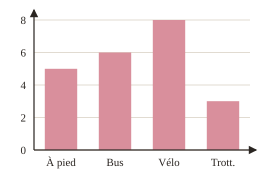
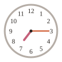
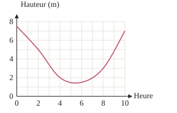




---Q---
Dans le calcul $13{,}5 - 2{,}4$, comment s'appellent les nombres $13{,}5$ et $2{,}4$ ?
---CORR---
Ce sont les termes de la différence.



---Q---
Calculer mentalement : $4{,}7 + 2{,}5 = \ldots$
---CORR---
$4{,}7 + 2{,}5 = {\color{#D36740}\boldsymbol{7{,}2}}$



---Q---
Décomposer en complétant :  
$47\,205 = (\ldots \times 10\,000) + (\ldots \times 1\,000) + (\ldots \times 100) + (\ldots \times 1)$
---CORR---
$47\,205 = ({\color{#D36740}\boldsymbol{4}} \times 10\,000) + ({\color{#D36740}\boldsymbol{7}} \times 1\,000) + ({\color{#D36740}\boldsymbol{2}} \times 100) + ({\color{#D36740}\boldsymbol{5}} \times 1)$



---Q---
Compléter : $\dfrac{1}{100} = \dfrac{\ldots}{1000}$
---CORR---
$\dfrac{1}{100} = \dfrac{{\color{#D36740}\boldsymbol{10}}}{1000}$



---Q---
Convertir : $5\,000$ m $= \ldots$ km
---CORR---
$5\,000$ m $= {\color{#D36740}\boldsymbol{5}}$ km







---Q---
Combien mesurent un angle plat et un angle droit ?
---CORR---
Angle plat : ${\color{#D36740}\boldsymbol{180°}}$ ; angle droit : ${\color{#D36740}\boldsymbol{90°}}$.



---Q---
Entre quelles valeurs est comprise la mesure d'un angle aigu ?
---CORR---
Entre ${\color{#D36740}\boldsymbol{0°}}$ et ${\color{#D36740}\boldsymbol{90°}}$ (strictement).



---Q---
On a demandé leur saison de naissance aux élèves d'une classe. 
<table class="auto-tab"><tr><th>Saison</th><th>Hiver</th><th>Printemps</th><th>Été</th><th>Automne</th></tr><tr><td>Effectif</td><td>8</td><td>12</td><td>6</td><td>4</td></tr></table> 
Combien d'élèves sont nés en été ?
---CORR---
${\color{#D36740}\boldsymbol{6}}$ élèves (colonne « Été »).



---Q---
Modes de transport des élèves (effectifs). 
Quel est le mode de transport le plus utilisé ? 

---CORR---
Le vélo : $8$ élèves, c'est la barre la plus haute.



---Q---
C'est le matin. 
Quelle heure est-il ? 

---CORR---
Il est ${\color{#D36740}\boldsymbol{7}}$ h ${\color{#D36740}\boldsymbol{15}}$ min.







---Q---
Entre quelles valeurs est comprise la mesure d'un angle obtus ?
---CORR---
Entre ${\color{#D36740}\boldsymbol{90°}}$ et ${\color{#D36740}\boldsymbol{180°}}$ (strictement).



---Q---
Classer ces angles par nature : $35°$, $90°$, $118°$, $180°$.
---CORR---
$35°$ aigu ; $90°$ droit ; $118°$ obtus ; $180°$ plat.



---Q---
Hauteur de la mer au cours de la journée. 
Quelle est la hauteur d'eau à $4$ h ? 

---CORR---
${\color{#D36740}\boldsymbol{2}}$ m : on lit l'ordonnée du point de la courbe d'abscisse $4$.



---Q---
Donner l'écriture décimale de $\dfrac{4}{100} + 20 + \dfrac{9}{10}$.
---CORR---
On range d'abord : $20 + \dfrac{9}{10} + \dfrac{4}{100} = {\color{#D36740}\boldsymbol{20{,}94}}$



---Q---
Calculer en respectant les priorités : $A = 12 - 5 \times 2$
---CORR---
$A = 12 - 10 = {\color{#D36740}\boldsymbol{2}}$ (la multiplication d'abord).



