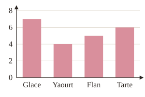
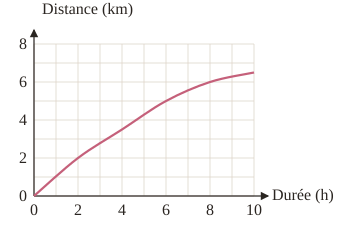




---Q---
Deux angles supplémentaires : l'un mesure $68°$. 
Combien mesure l'autre ?
---CORR---
$180° - 68° = {\color{#D36740}\boldsymbol{112°}}$



---Q---
Deux angles sont opposés par le sommet. 
L'un mesure $45°$. Et l'autre ?
---CORR---
${\color{#D36740}\boldsymbol{45°}}$ : deux angles opposés par le sommet ont la même mesure.



---Q---
Relevés météo d'une station. 
<table class="auto-tab"><tr><th></th><th>2023</th><th>2024</th><th>2025</th></tr><tr><td>Temp. max. (°C)</td><td>39</td><td>37,6</td><td>39,5</td></tr><tr><td>Précipitations (mm)</td><td>475</td><td>712</td><td>723</td></tr></table> 
De combien la température maximale a-t-elle baissé entre 2023 et 2024 ?
---CORR---
$39 - 37{,}6 = {\color{#D36740}\boldsymbol{1{,}4}}$ °C.



---Q---
Traduire ce calcul par une phrase en français : $12 + 7$.
---CORR---
La somme de $12$ et de $7$.



---Q---
Dans quelles tables de multiplication (jusqu'à $10$) trouve-t-on $24$ ?
---CORR---
$24 = 3 \times 8 = 4 \times 6$ : tables de ${\color{#D36740}\boldsymbol{3}}$, ${\color{#D36740}\boldsymbol{4}}$, ${\color{#D36740}\boldsymbol{6}}$ et ${\color{#D36740}\boldsymbol{8}}$.







---Q---
Combien mesure un angle plein ? un angle nul ?
---CORR---
Angle plein : ${\color{#D36740}\boldsymbol{360°}}$ ; angle nul : ${\color{#D36740}\boldsymbol{0°}}$.



---Q---
Combien mesure un quart de tour ? et un demi-tour ?
---CORR---
Un quart de tour : ${\color{#D36740}\boldsymbol{90°}}$ ; un demi-tour : ${\color{#D36740}\boldsymbol{180°}}$.



---Q---
Desserts préférés de $22$ collégiens (effectifs). 
Combien d'élèves préfèrent le flan ? 

---CORR---
${\color{#D36740}\boldsymbol{5}}$ élèves.



---Q---
Combien y a-t-il de centièmes dans un dixième ?
---CORR---
$\dfrac{1}{10} = \dfrac{{\color{#D36740}\boldsymbol{10}}}{100}$ : il y a ${\color{#D36740}\boldsymbol{10}}$ centièmes.



---Q---
Calculer en respectant les priorités : $A = 4 \times 5 + 6 \div 2$
---CORR---
$A = 20 + 3 = {\color{#D36740}\boldsymbol{23}}$ (multiplications et divisions d'abord).







---Q---
Deux angles supplémentaires : l'un mesure $90°$. 
Que peut-on dire de l'autre ?
---CORR---
$180° - 90° = {\color{#D36740}\boldsymbol{90°}}$ : c'est aussi un angle droit.



---Q---
Compléter la phrase : \nla bissectrice d'un angle est la demi-droite qui partage cet angle en deux angles $\ldots$ et $\ldots$
---CORR---
… en deux angles adjacents et de même mesure.



---Q---
Distance parcourue à vélo en fonction de la durée. 
Quelle distance a été parcourue en $6$ h ? 

---CORR---
${\color{#D36740}\boldsymbol{5}}$ km.



---Q---
Écrire $12 + \dfrac{45}{1000}$ sous forme décimale.
---CORR---
$45$ millièmes $= 0{,}045$, donc $12 + \dfrac{45}{1000} = {\color{#D36740}\boldsymbol{12{,}045}}$



---Q---
Donner le triple de $30$ et le quart de $48$.
---CORR---
Triple de $30$ : ${\color{#D36740}\boldsymbol{90}}$ ; quart de $48$ : ${\color{#D36740}\boldsymbol{12}}$



