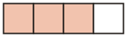
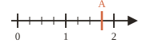
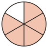
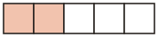
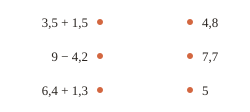




---Q---
Quelle fraction de la figure est colorée ? 

---CORR---
${\color{#D36740}\boldsymbol{\dfrac{3}{4}}}$ : $3$ parts colorées sur $4$ parts égales.



---Q---
Compléter : $\dfrac{1}{2} + \ldots = 1$
---CORR---
$\dfrac{1}{2} + {\color{#D36740}\boldsymbol{\dfrac{1}{2}}} = 1$



---Q---
Vrai ou faux : un angle de $89°$ est un angle obtus.
---CORR---
Faux : $89° < 90°$, c'est un angle aigu.



---Q---
Comment code-t-on sur une figure deux angles de même mesure ?
---CORR---
Par un même codage (le même petit arc) sur les deux angles.



---Q---
Quel est le produit de $9$ par $6$ ?
---CORR---
$9 \times 6 = {\color{#D36740}\boldsymbol{54}}$







---Q---
Calculer : $\dfrac{1}{4} + \dfrac{1}{4} = \ldots$
---CORR---
$\dfrac{1}{4} + \dfrac{1}{4} = \dfrac{2}{4} = {\color{#D36740}\boldsymbol{\dfrac{1}{2}}}$



---Q---
Donner l'écriture décimale de $\dfrac{3}{4}$.
---CORR---
$\dfrac{3}{4} = {\color{#D36740}\boldsymbol{0{,}75}}$



---Q---
Dans le nombre $4\,738\,021$, quel est le nombre de milliers ?
---CORR---
${\color{#D36740}\boldsymbol{4\,738}}$ : on lit tout ce qui est écrit jusqu'au rang des milliers.



---Q---
Donner l'abscisse du point $A$ sous forme de fraction. 

---CORR---
L'unité est partagée en $4$ : ${\color{#D36740}\boldsymbol{A\left(\dfrac{7}{4}\right)}}$



---Q---
Un disque représente une unité. 
Colorier la part correspondant à $\dfrac{5}{6}$. 

---CORR---
On colorie $5$ secteurs sur les $6$.







---Q---
Colorier les $\dfrac{2}{5}$ de la figure. 

---CORR---
On colorie $2$ parts sur les $5$.



---Q---
Vrai ou faux : $1 - \dfrac{1}{4} = \dfrac{3}{4}$.
---CORR---
Vrai : $\dfrac{4}{4} - \dfrac{1}{4} = \dfrac{3}{4}$.



---Q---
Relier chaque calcul à son résultat. 

---CORR---
$3{,}5 + 1{,}5 = {\color{#D36740}\boldsymbol{5}}$ ; $9 - 4{,}2 = {\color{#D36740}\boldsymbol{4{,}8}}$ ; $6{,}4 + 1{,}3 = {\color{#D36740}\boldsymbol{7{,}7}}$



---Q---
Arrondir $47{,}68$ au dixième.
---CORR---
$47{,}68 \approx {\color{#D36740}\boldsymbol{47{,}7}}$ (le chiffre des centièmes est $8 \geqslant 5$).



---Q---
Compléter : $5{,}214 = 5 + \dfrac{\ldots}{1000}$
---CORR---
$5{,}214 = 5 + \dfrac{{\color{#D36740}\boldsymbol{214}}}{1000}$



