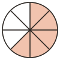
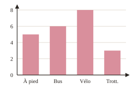
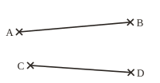




---Q---
Quel est le nombre qui, multiplié par $9$, donne $4$ ? 
Donner son écriture fractionnaire.
---CORR---
C'est ${\color{#D36740}\boldsymbol{\dfrac{4}{9}}}$ car $\dfrac{4}{9} \times 9 = 4$.



---Q---
Compléter : $\dfrac{3}{7} = \dfrac{\ldots}{28}$
---CORR---
$\dfrac{3}{7} = \dfrac{3 \times 4}{7 \times 4} = \dfrac{{\color{#D36740}\boldsymbol{12}}}{28}$



---Q---
Calculer : $3{,}5 \times 100 = \ldots$ et $0{,}42 \times 10 = \ldots$
---CORR---
$3{,}5 \times 100 = {\color{#D36740}\boldsymbol{350}}$ ; $0{,}42 \times 10 = {\color{#D36740}\boldsymbol{4{,}2}}$



---Q---
Donner un ordre de grandeur de $41{,}7 \times 4{,}9$.
---CORR---
$41{,}7 \approx 40$ et $4{,}9 \approx 5$, donc $40 \times 5 = {\color{#D36740}\boldsymbol{200}}$



---Q---
Calculer en respectant les priorités : $A = 20 - 3 + 7 - 2$
---CORR---
De gauche à droite : $A = 17 + 7 - 2 = 24 - 2 = {\color{#D36740}\boldsymbol{22}}$







---Q---
Comparer : $\dfrac{8}{9} \ldots \dfrac{5}{9}$
---CORR---
$\dfrac{8}{9} {\color{#D36740}\boldsymbol{>}} \dfrac{5}{9}$ : même dénominateur, on compare les numérateurs.



---Q---
Quelle fraction de la figure est colorée ? 

---CORR---
${\color{#D36740}\boldsymbol{\dfrac{5}{8}}}$



---Q---
Choix de LV2 dans un collège. 
<table class="auto-tab"><tr><th></th><th>Espagnol</th><th>Allemand</th><th>Italien</th></tr><tr><td>Filles</td><td>42</td><td>36</td><td>27</td></tr><tr><td>Garçons</td><td>58</td><td>20</td><td>33</td></tr></table> 
Que représente le nombre $33$ ?
---CORR---
Le nombre de garçons qui ont choisi italien.



---Q---
Modes de transport des élèves (effectifs). 
Combien d'élèves ont répondu à l'enquête ? 

---CORR---
$5 + 6 + 8 + 3 = {\color{#D36740}\boldsymbol{22}}$ élèves.



---Q---
Calculer : $\dfrac{1}{2} + \dfrac{1}{4} = \ldots$
---CORR---
$\dfrac{1}{2} + \dfrac{1}{4} = \dfrac{2}{4} + \dfrac{1}{4} = {\color{#D36740}\boldsymbol{\dfrac{3}{4}}}$







---Q---
Un cercle a pour centre $O$ et pour rayon $4$ cm. 
On place $M$ tel que $OM = 4$ cm. 
Où se trouve $M$ ?
---CORR---
Sur le cercle : tous ses points sont à $4$ cm de $O$.



---Q---
À l'aide du compas, déterminer quel segment est le plus long. 

---CORR---
On reporte la longueur $AB$ sur $[CD]$ au compas : $AB > CD$, le segment ${\color{#D36740}\boldsymbol{[AB]}}$ est le plus long.



---Q---
Comment note-t-on la droite qui passe par les points $A$ et $B$ ?
---CORR---
On la note ${\color{#D36740}\boldsymbol{(AB)}}$ (ou $(BA)$).



---Q---
Dans le calcul $6 \times 8$, comment s'appellent les nombres $6$ et $8$ ?
---CORR---
Ce sont les facteurs du produit.



---Q---
Décomposer avec des fractions décimales : $0{,}706 = \ldots$
---CORR---
$0{,}706 = {\color{#D36740}\boldsymbol{\dfrac{7}{10} + \dfrac{6}{1000}}}$



