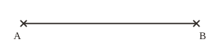
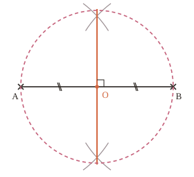




---Q---
Au compas, on reporte $AB = 4$ cm trois fois de suite sur une demi-droite. Quelle longueur obtient-on ?
---CORR---
$4 \times 3 = {\color{#D36740}\boldsymbol{12}}$ cm.



---Q---
Un cercle a un rayon de $5{,}5$ cm. Quelle est la longueur d'un diamètre ?
---CORR---
Le diamètre mesure deux rayons : $5{,}5 \times 2 = {\color{#D36740}\boldsymbol{11}}$ cm.



---Q---
Calculer mentalement : $10 - 3{,}6 = \ldots$
---CORR---
$10 - 3{,}6 = {\color{#D36740}\boldsymbol{6{,}4}}$



---Q---
$[OT)$ est la bissectrice de $\widehat{ROS} = 84°$. Combien mesure $\widehat{ROT}$ ?
---CORR---
$84° \div 2 = {\color{#D36740}\boldsymbol{42°}}$



---Q---
Compléter : $\ldots - 37 = 54$
---CORR---
$54 + 37 = 91$, donc ${\color{#D36740}\boldsymbol{91}} - 37 = 54$







---Q---
Tracer au compas la médiatrice du segment $[AB]$. 

---CORR---
On trace deux arcs de même rayon (plus grand que la moitié de $AB$), centrés en $A$ puis en $B$. La droite qui passe par leurs deux points d'intersection est la médiatrice.



---Q---
Nommer $O$ le point d'intersection de la médiatrice et de $[AB]$. Que représente $O$ pour $[AB]$ ?
---CORR---
$O$ est le milieu de $[AB]$ : la médiatrice coupe le segment en son milieu.



---Q---
Tracer le cercle de centre $O$ passant par $A$. Passe-t-il par $B$ ?
---CORR---
Oui : $OA = OB$ car $O$ est le milieu de $[AB]$, donc $B$ est aussi sur ce cercle.



